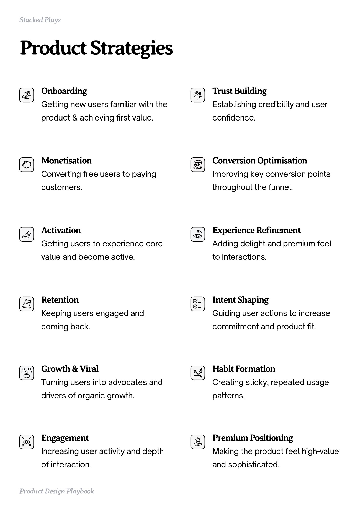

# PDF page 005

Source: `docs/ProductDesignPlaybook_V2.0.pdf`, page 5 of 206.

[Open the full-page screenshot](../../screenshots/page-005.jpg)



## Extracted text

```text
Stacked Plays

Product Strategies
Onboarding


Trust Building


Getting new users familiar with the

Establishing credibility and user

product & achieving first value.

confidence.

Monetisation


Conversion Optimisation


Converting free users to paying

Improving key conversion points

customers.

throughout the funnel.

Activation


Experience Refinement


Getting users to experience core

Adding delight and premium feel

value and become active.

to interactions.

Retention


Intent Shaping


Keeping users engaged and

Guiding user actions to increase

coming back.

commitment and product fit.

Growth & Viral


Habit Formation


drivers of organic growth.

patterns.

Engagement


Premium Positioning


Turning users into advocates and

Creating sticky, repeated usage

Increasing user activity and depth

Making the product feel high-value

of interaction.

and sophisticated.

Product Design Playbook
```
