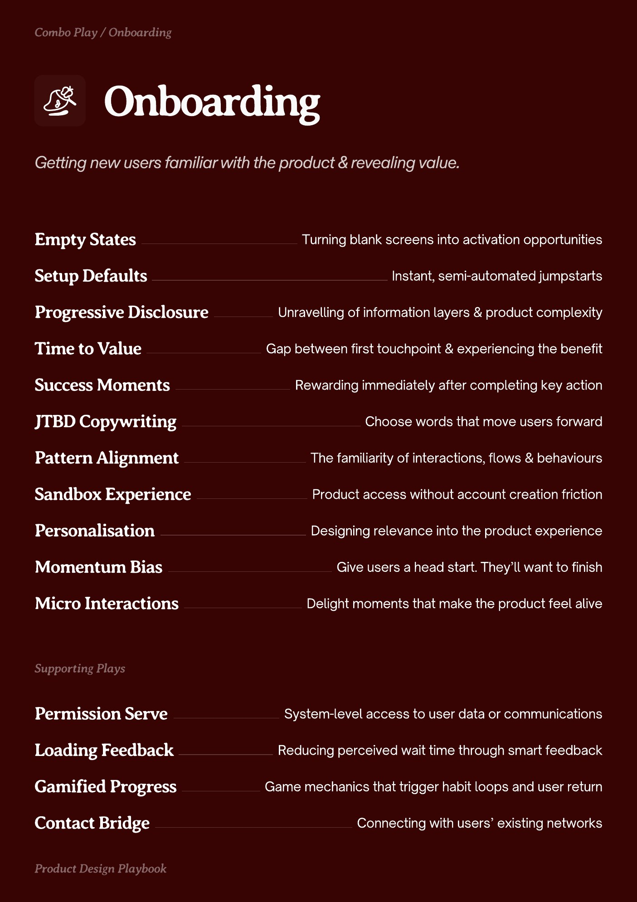

# PDF page 006

Source: `docs/ProductDesignPlaybook_V2.0.pdf`, page 6 of 206.

[Open the full-page screenshot](../../screenshots/page-006.jpg)



## Extracted text

```text
nboarding

Empty States
Setup Defaults
Progressive Disclosure
Time to Value

Turning blank screens into activation opportunities
Instant, semi-automated jumpstarts
Unravelling of information layers & product complexity
Gap between first touchpoint & experiencing the benefit

Success Moments

Rewarding immediately after completing key action

JTBD Copywriting

Choose words that move users forward

Pattern Alignment

The familiarity of interactions, flows & behaviours

Sandbox Experience

Product access without account creation friction

Personalisation

Designing relevance into the product experience

Momentum Bias

Give users a head start. They’ll want to finish

Micro Interactions

Delight moments that make the product feel alive

Permission Serve

System-level access to user data or communications

Loading Feedback

Reducing perceived wait time through smart feedback

Gamified Progress

Game mechanics that trigger habit loops and user return

Contact Bridge

Connecting with users’ existing networks
```
