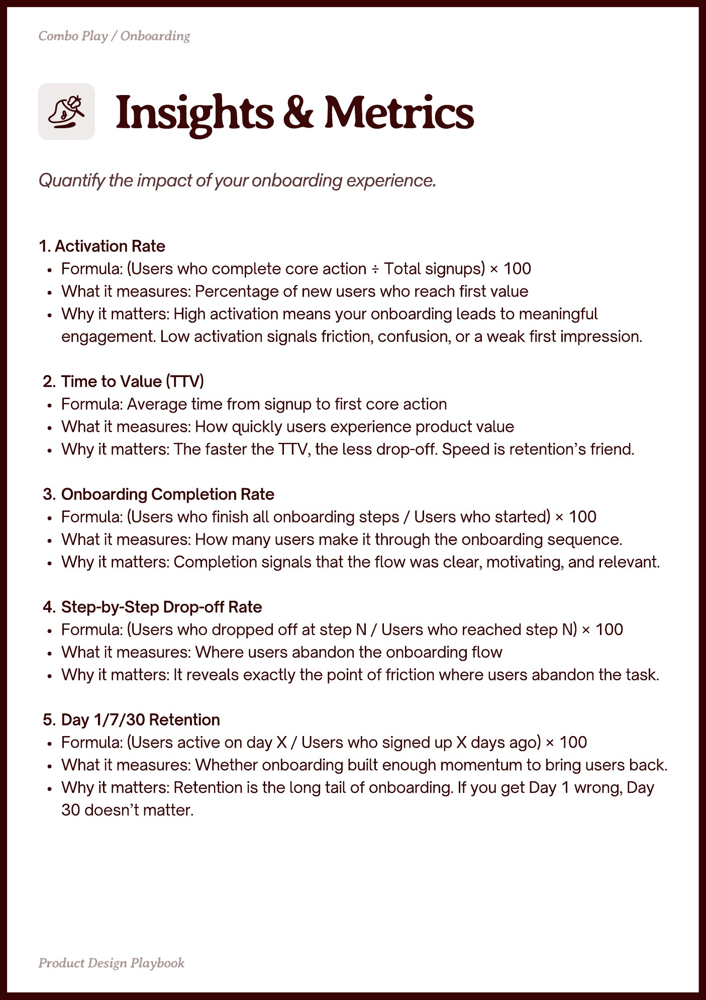

# PDF page 007

Source: `docs/ProductDesignPlaybook_V2.0.pdf`, page 7 of 206.

[Open the full-page screenshot](../../screenshots/page-007.jpg)



## Extracted text

```text
1. Activation Rate

Formula: (Users who complete core action ÷ Total signups) × 100

What it measures: Percentage of new users who reach first value

Why it matters: High activation means your onboarding leads to meaningful
engagement. Low activation signals friction, confusion, or a weak first impression.


Time to Value (TTV)

Formula: Average time from signup to first core action

What it measures: How quickly users experience product value

Why it matters: The faster the TTV, the less drop-off. Speed is retention’s friend.


Onboarding Completion Rate

Formula: (Users who finish all onboarding steps / Users who started) × 100

What it measures: How many users make it through the onboarding sequence.

Why it matters: Completion signals that the flow was clear, motivating, and relevant.


Step-by-Step Drop-off Rate

Formula: (Users who dropped off at step N / Users who reached step N) × 100

What it measures: Where users abandon the onboarding flow

Why it matters: It reveals exactly the point of friction where users abandon the task.


Day 1/7/30 Retention

Formula: (Users active on day X / Users who signed up X days ago) × 100

What it measures: Whether onboarding built enough momentum to bring users back.

Why it matters: Retention is the long tail of onboarding. If you get Day 1 wrong, Day
30 doesn’t matter.
```
