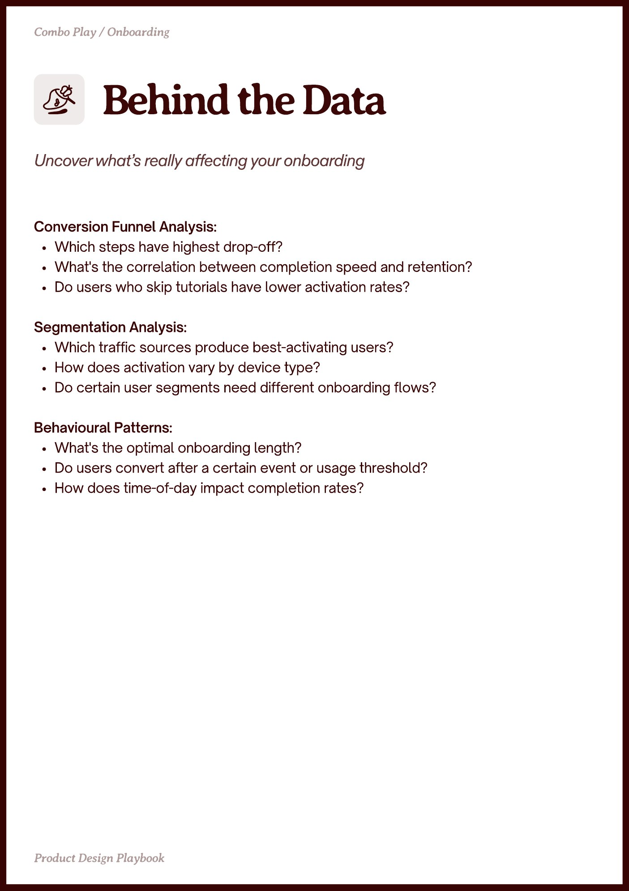

# PDF page 008

Source: `docs/ProductDesignPlaybook_V2.0.pdf`, page 8 of 206.

[Open the full-page screenshot](../../screenshots/page-008.jpg)



## Extracted text

```text
Conversion Funnel Analysis:

Which steps have highest drop-off?

What's the correlation between completion speed and retention?

Do users who skip tutorials have lower activation rates?


Segmentation Analysis:

Which traffic sources produce best-activating users?

How does activation vary by device type?

Do certain user segments need different onboarding flows?


Behavioural Patterns:

What's the optimal onboarding length?

Do users convert after a certain event or usage threshold?

How does time-of-day impact completion rates?
```
