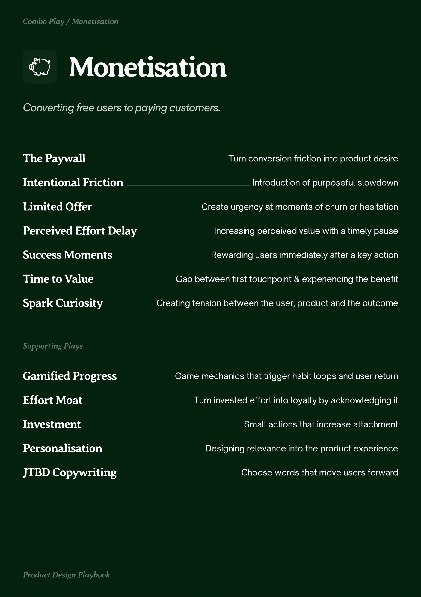

# PDF page 009

Source: `docs/ProductDesignPlaybook_V2.0.pdf`, page 9 of 206.

[Open the full-page screenshot](../../screenshots/page-009.jpg)



## Extracted text

```text
Monetisation

The Paywall
Intentional Friction
Limited Offer

Turn conversion friction into product desire

Introduction of purposeful slowdown

Create urgency at moments of churn or hesitation

Perceived Effort Delay

Increasing perceived value with a timely pause

Success Moments

Rewarding users immediately after a key action

Time to Value
Spark Curiosity

Gamified Progress

Gap between first touchpoint & experiencing the benefit

Creating tension between the user, product and the outcome

Game mechanics that trigger habit loops and user return

Effort Moat

Turn invested effort into loyalty by acknowledging it

Investment

Small actions that increase attachment

Personalisation
JTBD Copywriting

Designing relevance into the product experience

Choose words that move users forward
```
