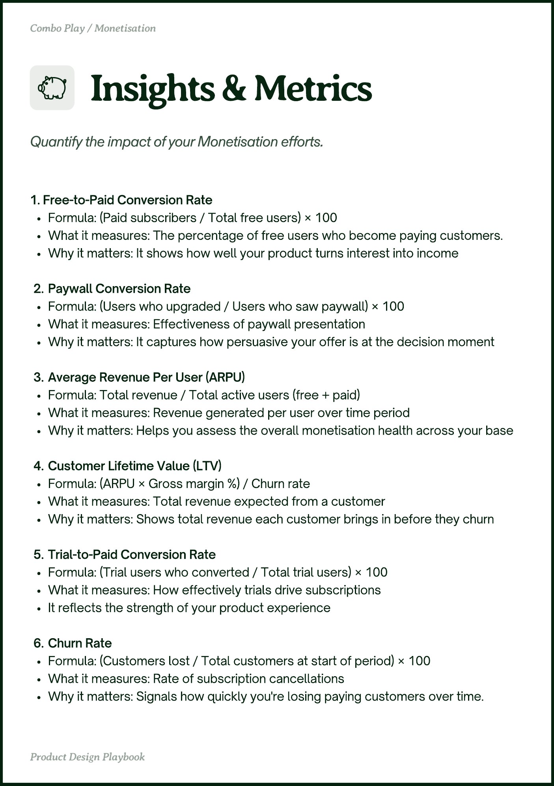

# PDF page 010

Source: `docs/ProductDesignPlaybook_V2.0.pdf`, page 10 of 206.

[Open the full-page screenshot](../../screenshots/page-010.jpg)



## Extracted text

```text
1. Free-to-Paid Conversion Rate


Formula: (Paid subscribers / Total free users) × 100


What it measures: The percentage of free users who become paying customers.


Why it matters: It shows how well your product turns interest into income


Paywall Conversion Rate


Formula: (Users who upgraded / Users who saw paywall) × 100


What it measures: Effectiveness of paywall presentation


Why it matters: It captures how persuasive your offer is at the decision moment



Average Revenue Per User (ARPU)


Formula: Total revenue / Total active users (free + paid)


What it measures: Revenue generated per user over time period


Why it matters: Helps you assess the overall monetisation health across your base



Customer Lifetime Value (LTV)


Formula: (ARPU × Gross margin %) / Churn rate


What it measures: Total revenue expected from a customer


Why it matters: Shows total revenue each customer brings in before they churn



Trial-to-Paid Conversion Rate


Formula: (Trial users who converted / Total trial users) × 100


What it measures: How effectively trials drive subscriptions


It reflects the strength of your product experience


Churn Rate


Formula: (Customers lost / Total customers at start of period) × 100


What it measures: Rate of subscription cancellations


Why it matters: Signals how quickly you're losing paying customers over time.
```
