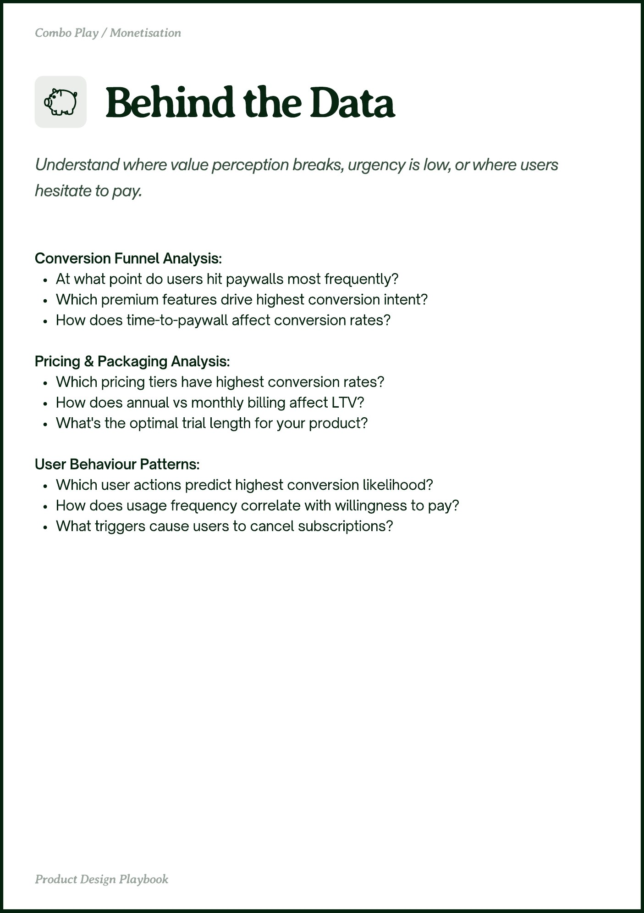

# PDF page 011

Source: `docs/ProductDesignPlaybook_V2.0.pdf`, page 11 of 206.

[Open the full-page screenshot](../../screenshots/page-011.jpg)



## Extracted text

```text
Conversion Funnel Analysis:

At what point do users hit paywalls most frequently?

Which premium features drive highest conversion intent?

How does time-to-paywall affect conversion rates?


Pricing & Packaging Analysis:

Which pricing tiers have highest conversion rates?

How does annual vs monthly billing affect LTV?

What's the optimal trial length for your product?


User Behaviour Patterns:

Which user actions predict highest conversion likelihood?

How does usage frequency correlate with willingness to pay?

What triggers cause users to cancel subscriptions?
```
