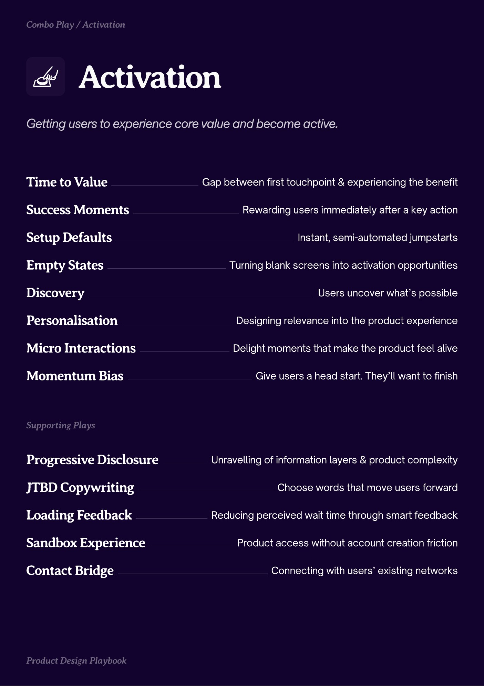

# PDF page 012

Source: `docs/ProductDesignPlaybook_V2.0.pdf`, page 12 of 206.

[Open the full-page screenshot](../../screenshots/page-012.jpg)



## Extracted text

```text
ctivation
Time to Value
Success Moments
Setup Defaults
Empty States
Discovery

Gap between first touchpoint & experiencing the benefit
Rewarding users immediately after a key action
Instant, semi-automated jumpstarts
Turning blank screens into activation opportunities
Users uncover what’s possible

Personalisation

Designing relevance into the product experience

Micro Interactions

Delight moments that make the product feel alive

Momentum Bias

Progressive Disclosure
JTBD Copywriting

Loading Feedback
Sandbox Experience
Contact Bridge

Give users a head start. They’ll want to finish

Unravelling of information layers & product complexity

Choose words that move users forward
Reducing perceived wait time through smart feedback

Product access without account creation friction
Connecting with users’ existing networks
```
