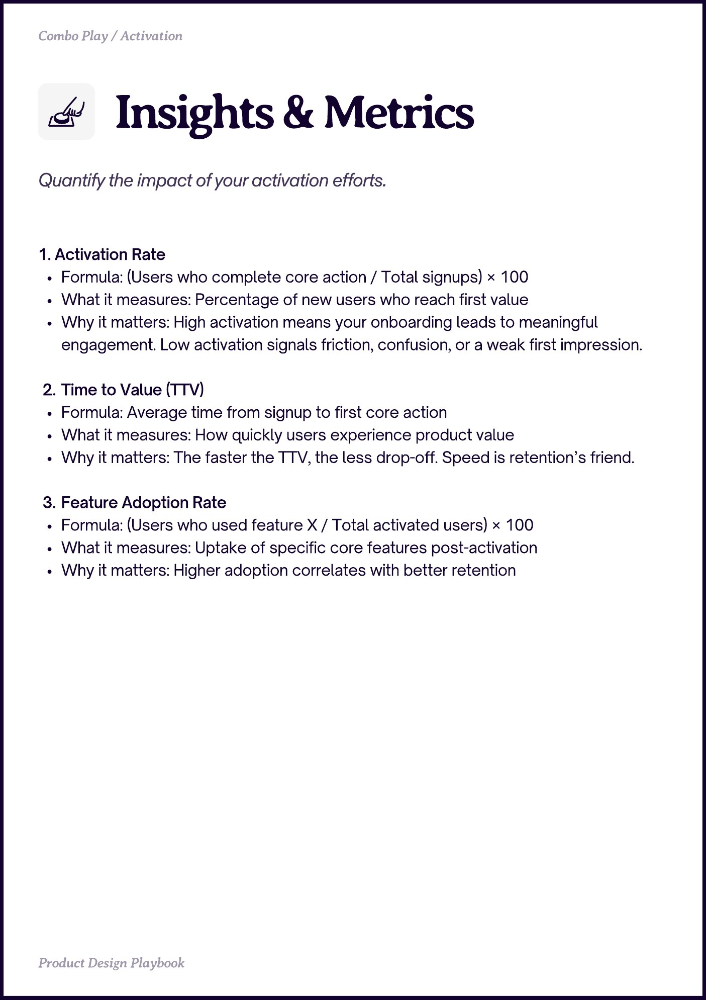

# PDF page 013

Source: `docs/ProductDesignPlaybook_V2.0.pdf`, page 13 of 206.

[Open the full-page screenshot](../../screenshots/page-013.jpg)



## Extracted text

```text
Insights & Metrics
1. Activation Rate

Formula: (Users who complete core action / Total signups) × 100

What it measures: Percentage of new users who reach first value

Why it matters: High activation means your onboarding leads to meaningful
engagement. Low activation signals friction, confusion, or a weak first impression.


Time to Value (TTV)

Formula: Average time from signup to first core action

What it measures: How quickly users experience product value

Why it matters: The faster the TTV, the less drop-off. Speed is retention’s friend.


Feature Adoption Rate

Formula: (Users who used feature X / Total activated users) × 100

What it measures: Uptake of specific core features post-activation

Why it matters: Higher adoption correlates with better retention
```
