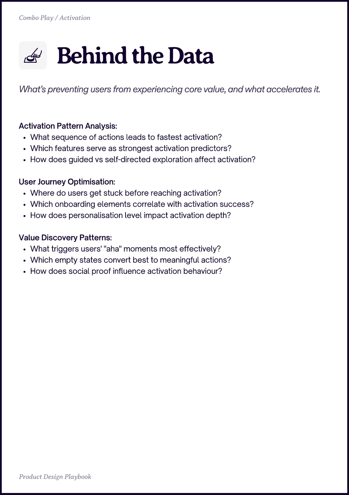

# PDF page 014

Source: `docs/ProductDesignPlaybook_V2.0.pdf`, page 14 of 206.

[Open the full-page screenshot](../../screenshots/page-014.jpg)



## Extracted text

```text
Behind the Data
Activation Pattern Analysis:

What sequence of actions leads to fastest activation?

Which features serve as strongest activation predictors?

How does guided vs self-directed exploration affect activation?


User Journey Optimisation:

Where do users get stuck before reaching activation?

Which onboarding elements correlate with activation success?

How does personalisation level impact activation depth?


Value Discovery Patterns:

What triggers users' "aha" moments most effectively?

Which empty states convert best to meaningful actions?

How does social proof influence activation behaviour?
```
