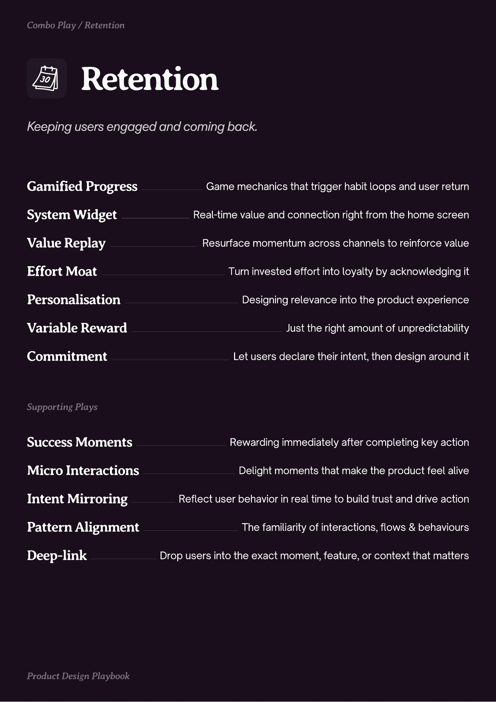

# PDF page 015

Source: `docs/ProductDesignPlaybook_V2.0.pdf`, page 15 of 206.

[Open the full-page screenshot](../../screenshots/page-015.jpg)



## Extracted text

```text
Retention

Gamified Progress

Game mechanics that trigger habit loops and user return

System Widget

Real-time value and connection right from the home screen

Value Replay

Resurface momentum across channels to reinforce value

Effort Moat
Personalisation
Variable Reward

Turn invested effort into loyalty by acknowledging it
Designing relevance into the product experience
Just the right amount of unpredictability

Commitment

Let users declare their intent, then design around it

Success Moments

Rewarding immediately after completing key action

Micro Interactions

Delight moments that make the product feel alive

Intent Mirroring
Pattern Alignment
Deep-link

Reflect user behavior in real time to build trust and drive action
The familiarity of interactions, flows & behaviours
Drop users into the exact moment, feature, or context that matters
```
