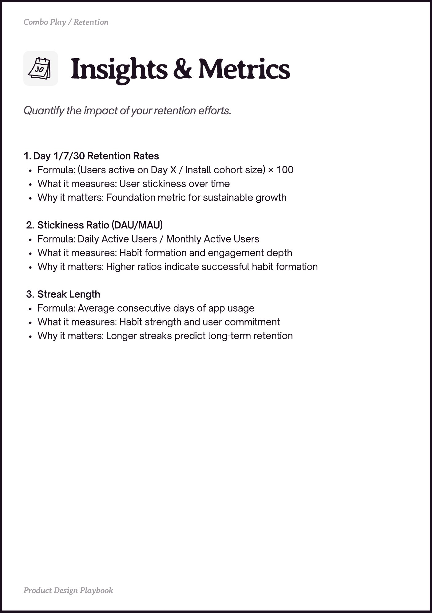

# PDF page 016

Source: `docs/ProductDesignPlaybook_V2.0.pdf`, page 16 of 206.

[Open the full-page screenshot](../../screenshots/page-016.jpg)



## Extracted text

```text
1. Day 1/7/30 Retention Rates

Formula: (Users active on Day X / Install cohort size) × 100

What it measures: User stickiness over time

Why it matters: Foundation metric for sustainable growth



Stickiness Ratio (DAU/MAU)

Formula: Daily Active Users / Monthly Active Users

What it measures: Habit formation and engagement depth

Why it matters: Higher ratios indicate successful habit formation



Streak Length

Formula: Average consecutive days of app usage

What it measures: Habit strength and user commitment

Why it matters: Longer streaks predict long-term retention
```
