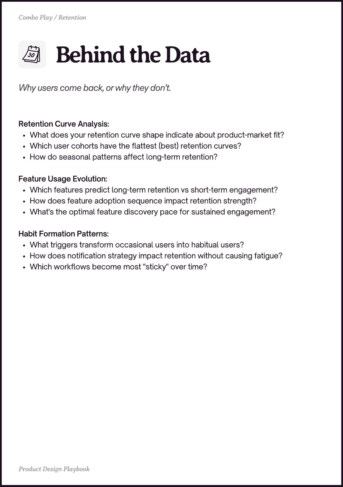

# PDF page 017

Source: `docs/ProductDesignPlaybook_V2.0.pdf`, page 17 of 206.

[Open the full-page screenshot](../../screenshots/page-017.jpg)



## Extracted text

```text
Retention Curve Analysis:

What does your retention curve shape indicate about product-market fit?

Which user cohorts have the flattest (best) retention curves?

How do seasonal patterns affect long-term retention?



Feature Usage Evolution:

Which features predict long-term retention vs short-term engagement?

How does feature adoption sequence impact retention strength?

What's the optimal feature discovery pace for sustained engagement?



Habit Formation Patterns:

What triggers transform occasional users into habitual users?

How does notification strategy impact retention without causing fatigue?

Which workflows become most "sticky" over time?
```
