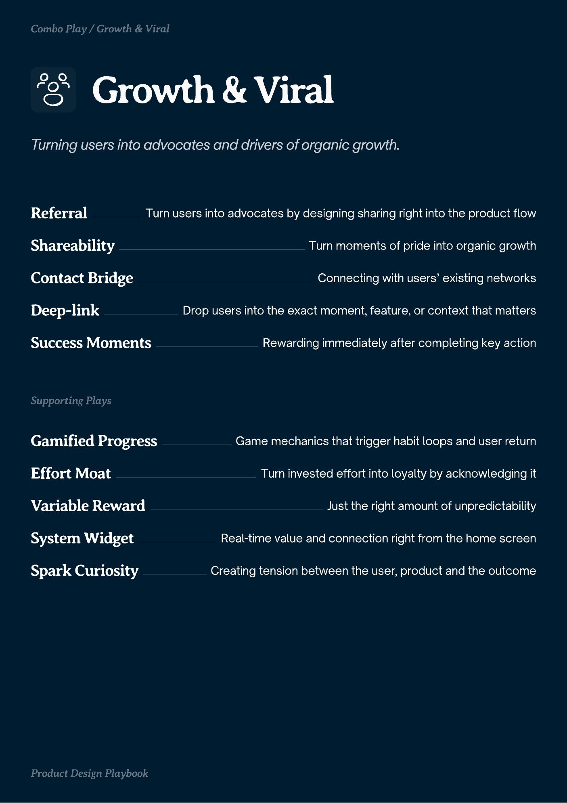

# PDF page 018

Source: `docs/ProductDesignPlaybook_V2.0.pdf`, page 18 of 206.

[Open the full-page screenshot](../../screenshots/page-018.jpg)



## Extracted text

```text
Growth Viral
Referral

Turn users into advocates by designing sharing right into the product flow

Shareability
Contact Bridge
Deep-link

Turn moments of pride into organic growth
Connecting with users’ existing networks
Drop users into the exact moment, feature, or context that matters

Success Moments

Rewarding immediately after completing key action

Gamified Progress

Game mechanics that trigger habit loops and user return

Effort Moat
Variable Reward

Turn invested effort into loyalty by acknowledging it
Just the right amount of unpredictability

System Widget

Real-time value and connection right from the home screen

Spark Curiosity

Creating tension between the user, product and the outcome
```
