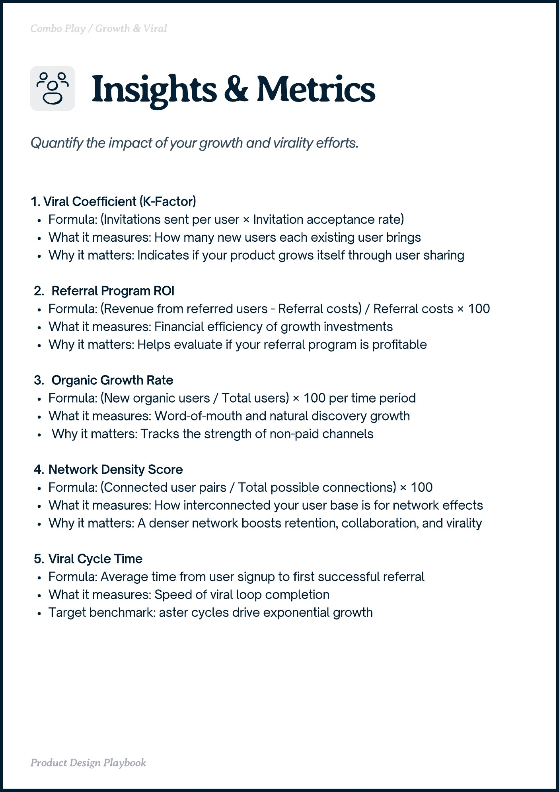

# PDF page 019

Source: `docs/ProductDesignPlaybook_V2.0.pdf`, page 19 of 206.

[Open the full-page screenshot](../../screenshots/page-019.jpg)



## Extracted text

```text
obo Play rot iral

O

1. Viral Coefficient (K-Factor)

Formula: (Invitations sent per user × Invitation acceptance rate)

What it measures: How many new users each existing user brings

Why it matters: Indicates if your product grows itself through user sharing


Referral Program ROI

Formula: (Revenue from referred users - Referral costs) / Referral costs × 100

What it measures: Financial efficiency of growth investments

Why it matters: Helps evaluate if your referral program is profitable


Organic Growth Rate

Formula: (New organic users / Total users) × 100 per time period

What it measures: Word-of-mouth and natural discovery growth

Why it matters: Tracks the strength of non-paid channels


Network Density Score

Formula: (Connected user pairs / Total possible connections) × 100

What it measures: How interconnected your user base is for network effects

Why it matters: A denser network boosts retention, collaboration, and virality


Viral Cycle Time

Formula: Average time from user signup to first successful referral

What it measures: Speed of viral loop completion

Target benchmark: aster cycles drive exponential growth

Product Design Playbook
```
