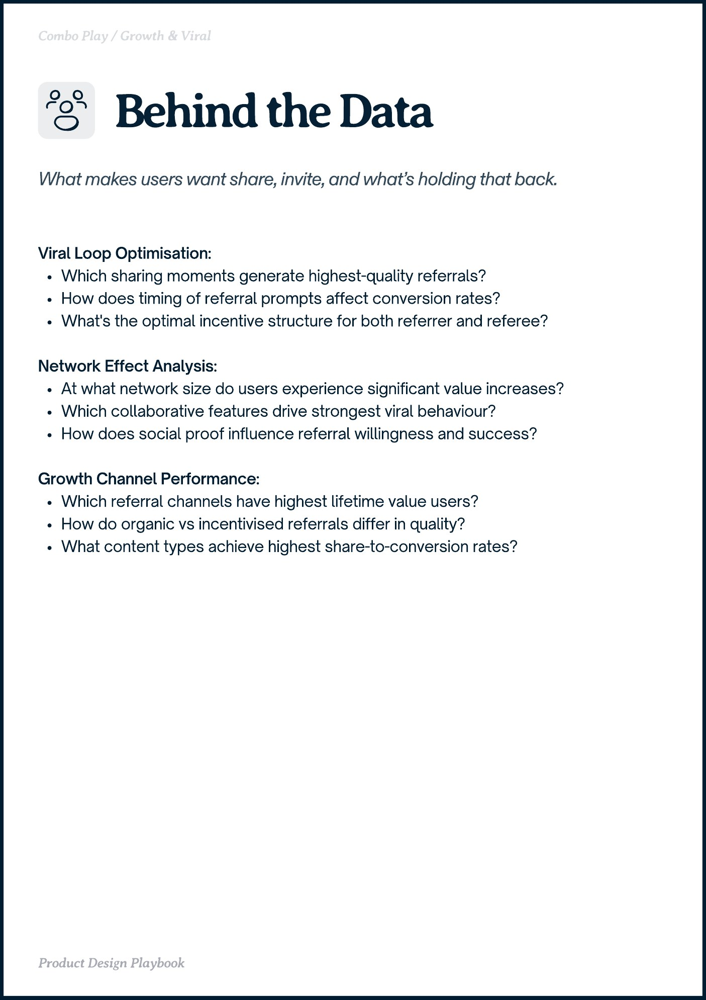

# PDF page 020

Source: `docs/ProductDesignPlaybook_V2.0.pdf`, page 20 of 206.

[Open the full-page screenshot](../../screenshots/page-020.jpg)



## Extracted text

```text
obo Play rot iral

Viral Loop Optimisation:

Which sharing moments generate highest-quality referrals?

How does timing of referral prompts affect conversion rates?

What's the optimal incentive structure for both referrer and referee?


Network Effect Analysis:

At what network size do users experience significant value increases?

Which collaborative features drive strongest viral behaviour?

How does social proof influence referral willingness and success?


Growth Channel Performance:

Which referral channels have highest lifetime value users?

How do organic vs incentivised referrals differ in quality?

What content types achieve highest share-to-conversion rates?

Product Design Playbook
```
