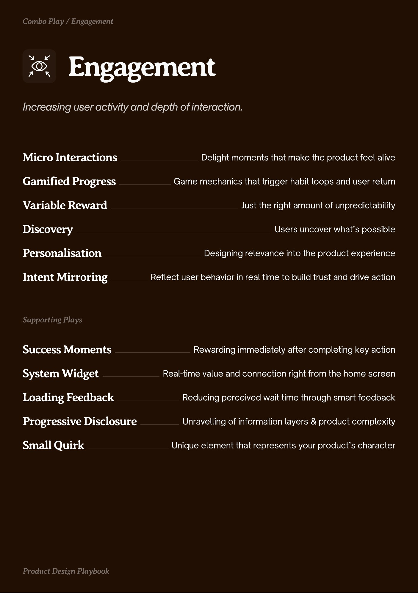

# PDF page 021

Source: `docs/ProductDesignPlaybook_V2.0.pdf`, page 21 of 206.

[Open the full-page screenshot](../../screenshots/page-021.jpg)



## Extracted text

```text
ngagement

Micro Interactions

Delight moments that make the product feel alive

Gamified Progress

Game mechanics that trigger habit loops and user return

Variable Reward
Discovery
Personalisation

Just the right amount of unpredictability
Users uncover what’s possible
Designing relevance into the product experience

Intent Mirroring

Reflect user behavior in real time to build trust and drive action

Success Moments

Rewarding immediately after completing key action

System Widget

Real-time value and connection right from the home screen

Loading Feedback

Reducing perceived wait time through smart feedback

Progressive Disclosure

Unravelling of information layers & product complexity

Small Quirk

Unique element that represents your product’s character
```
