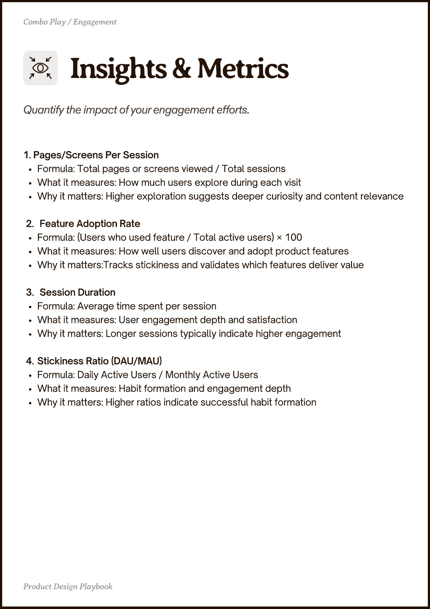

# PDF page 022

Source: `docs/ProductDesignPlaybook_V2.0.pdf`, page 22 of 206.

[Open the full-page screenshot](../../screenshots/page-022.jpg)



## Extracted text

```text
Combo Play / Engagement

1. Pages/Screens Per Session

Formula: Total pages or screens viewed / Total sessions

What it measures: How much users explore during each visit

Why it matters: Higher exploration suggests deeper curiosity and content relevance


Feature Adoption Rate

Formula: (Users who used feature / Total active users) × 100

What it measures: How well users discover and adopt product features

Why it matters:Tracks stickiness and validates which features deliver value


Session Duration

Formula: Average time spent per session

What it measures: User engagement depth and satisfaction

Why it matters: Longer sessions typically indicate higher engagement


Stickiness Ratio (DAU/MAU)

Formula: Daily Active Users / Monthly Active Users

What it measures: Habit formation and engagement depth

Why it matters: Higher ratios indicate successful habit formation

Pot egn Playboo
```
