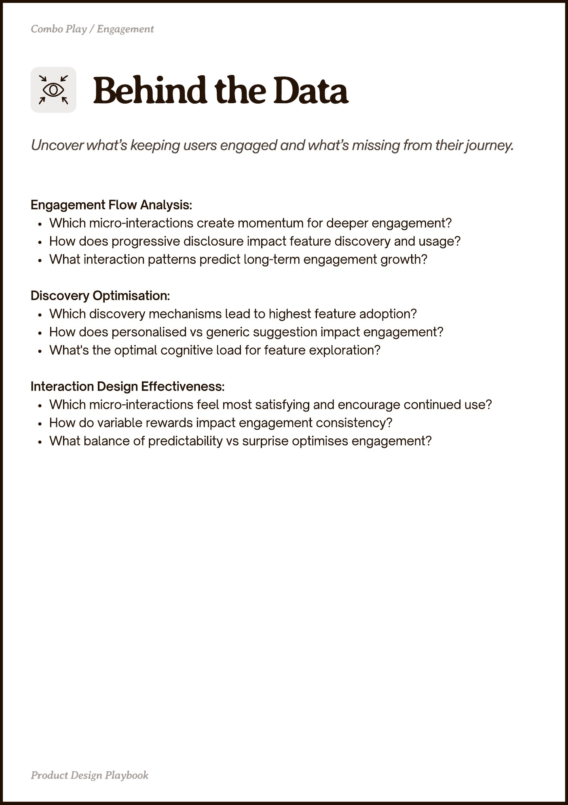

# PDF page 023

Source: `docs/ProductDesignPlaybook_V2.0.pdf`, page 23 of 206.

[Open the full-page screenshot](../../screenshots/page-023.jpg)



## Extracted text

```text
Combo Play / Engagement

Engagement Flow Analysis:

Which micro-interactions create momentum for deeper engagement?

How does progressive disclosure impact feature discovery and usage?

What interaction patterns predict long-term engagement growth?


Discovery Optimisation:

Which discovery mechanisms lead to highest feature adoption?

How does personalised vs generic suggestion impact engagement?

What's the optimal cognitive load for feature exploration?


Interaction Design Effectiveness:

Which micro-interactions feel most satisfying and encourage continued use?

How do variable rewards impact engagement consistency?

What balance of predictability vs surprise optimises engagement?

Pot egn Playboo
```
