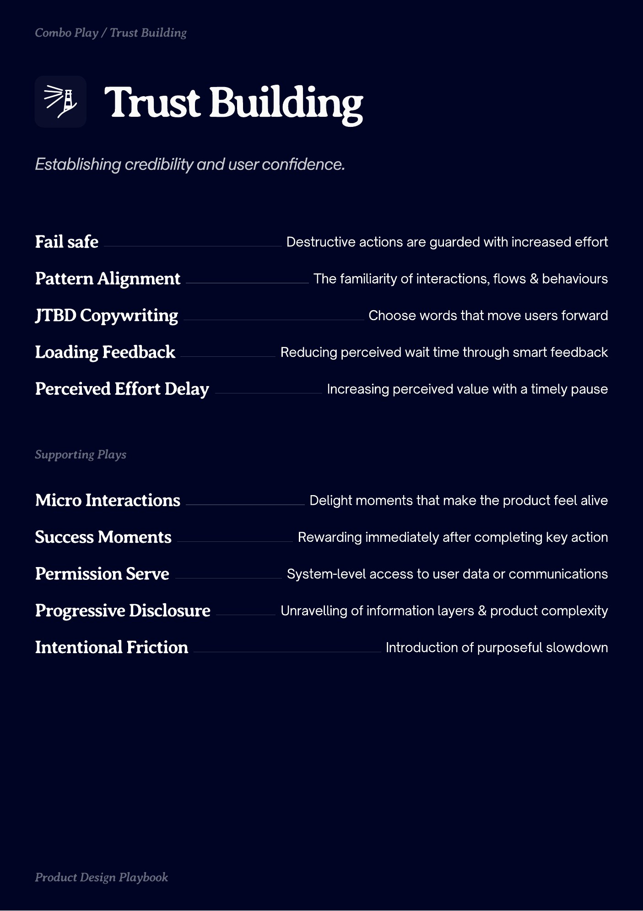

# PDF page 024

Source: `docs/ProductDesignPlaybook_V2.0.pdf`, page 24 of 206.

[Open the full-page screenshot](../../screenshots/page-024.jpg)



## Extracted text

```text
Combo Play / Trust Building

Trust Building
Fail safe

Destructive actions are guarded with increased effort

Pattern Alignment

The familiarity of interactions, flows & behaviours

JTBD Copywriting

Choose words that move users forward

Loading Feedback

Reducing perceived wait time through smart feedback

Perceived Effort Delay

Increasing perceived value with a timely pause

urting ls

Micro Interactions

Delight moments that make the product feel alive

Success Moments

Rewarding immediately after completing key action

Permission Serve

System-level access to user data or communications

Progressive Disclosure

Unravelling of information layers & product complexity

Intentional Friction

rdut sign l

Introduction of purposeful slowdown
```
