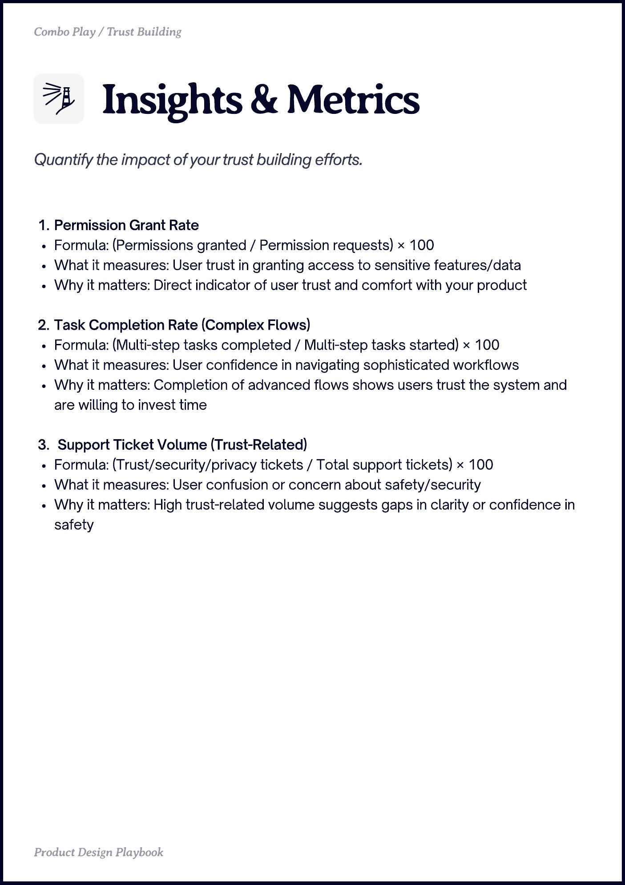

# PDF page 025

Source: `docs/ProductDesignPlaybook_V2.0.pdf`, page 25 of 206.

[Open the full-page screenshot](../../screenshots/page-025.jpg)



## Extracted text

```text
Combo Play / Trust Building

Permission Grant Rate

Formula: (Permissions granted / Permission requests) × 100

What it measures: User trust in granting access to sensitive features/data

Why it matters: Direct indicator of user trust and comfort with your product


Task Completion Rate (Complex Flows)

Formula: (Multi-step tasks completed / Multi-step tasks started) × 100

What it measures: User confidence in navigating sophisticated workflows

Why it matters: Completion of advanced flows shows users trust the system and
are willing to invest time


Support Ticket Volume (Trust-Related)

Formula: (Trust/security/privacy tickets / Total support tickets) × 100

What it measures: User confusion or concern about safety/security

Why it matters: High trust-related volume suggests gaps in clarity or confidence in
safety

Produt sign Playboo
```
