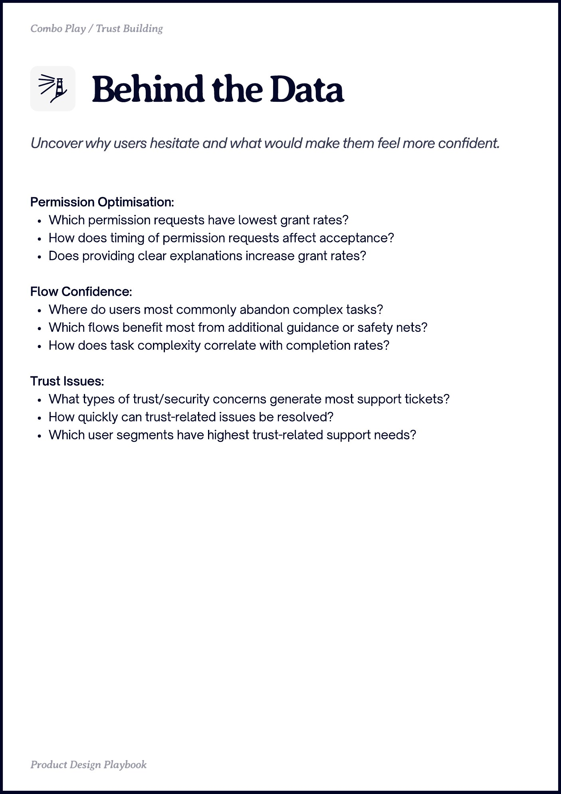

# PDF page 026

Source: `docs/ProductDesignPlaybook_V2.0.pdf`, page 26 of 206.

[Open the full-page screenshot](../../screenshots/page-026.jpg)



## Extracted text

```text
Combo Play / Trust Building

Permission Optimisation:

Which permission requests have lowest grant rates?

How does timing of permission requests affect acceptance?

Does providing clear explanations increase grant rates?


Flow Confidence:

Where do users most commonly abandon complex tasks?

Which flows benefit most from additional guidance or safety nets?

How does task complexity correlate with completion rates?


Trust Issues:

What types of trust/security concerns generate most support tickets?

How quickly can trust-related issues be resolved?

Which user segments have highest trust-related support needs?

Produt sign Playboo
```
