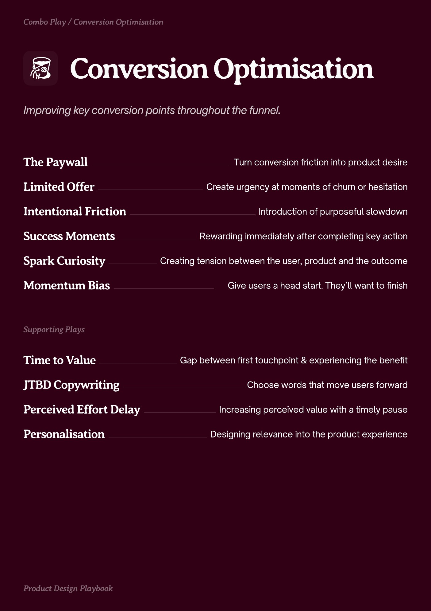

# PDF page 027

Source: `docs/ProductDesignPlaybook_V2.0.pdf`, page 27 of 206.

[Open the full-page screenshot](../../screenshots/page-027.jpg)



## Extracted text

```text
Combo Play / Conversion Optimisation

Conversion Optimisation
The Paywall
Limited Offer
Intentional Friction
Success Moments

Turn conversion friction into product desire
Create urgency at moments of churn or hesitation
Introduction of purposeful slowdown
Rewarding immediately after completing key action

Spark Curiosity

Creating tension between the user, product and the outcome

Momentum Bias

Give users a head start. They’ll want to finish

pportin Plays

Time to Value
JTBD Copywriting
Perceived Effort Delay
Personalisation

Prot esin Playboo

Gap between first touchpoint & experiencing the benefit
Choose words that move users forward
Increasing perceived value with a timely pause

Designing relevance into the product experience
```
