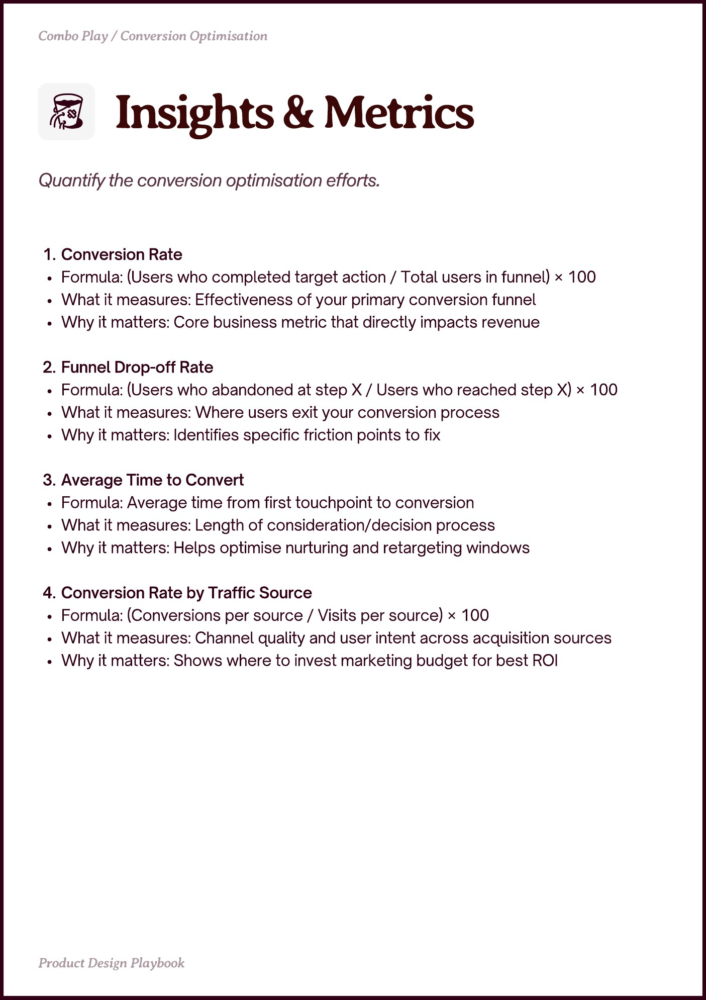

# PDF page 028

Source: `docs/ProductDesignPlaybook_V2.0.pdf`, page 28 of 206.

[Open the full-page screenshot](../../screenshots/page-028.jpg)



## Extracted text

```text
Combo Play / Conversion Optimisation

Conversion Rate

Formula: (Users who completed target action / Total users in funnel) × 100

What it measures: Effectiveness of your primary conversion funnel

Why it matters: Core business metric that directly impacts revenue


Funnel Drop-off Rate

Formula: (Users who abandoned at step X / Users who reached step X) × 100

What it measures: Where users exit your conversion process

Why it matters: Identifies specific friction points to fix


Average Time to Convert

Formula: Average time from first touchpoint to conversion

What it measures: Length of consideration/decision process

Why it matters: Helps optimise nurturing and retargeting windows


Conversion Rate by Traffic Source

Formula: (Conversions per source / Visits per source) × 100

What it measures: Channel quality and user intent across acquisition sources

Why it matters: Shows where to invest marketing budget for best ROI

Prot esin Playboo
```
