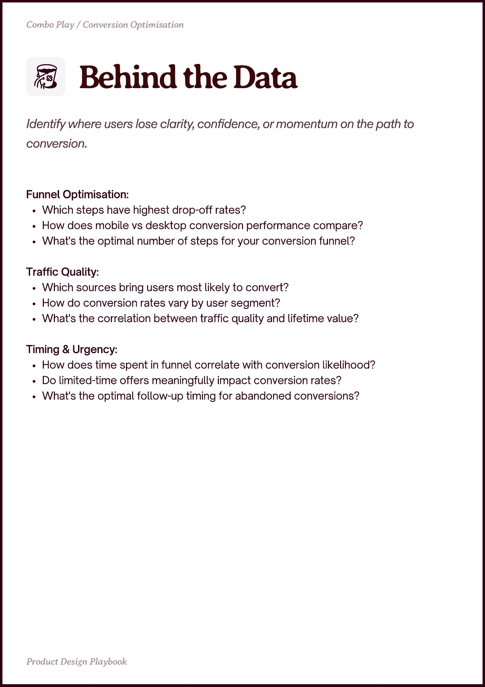

# PDF page 029

Source: `docs/ProductDesignPlaybook_V2.0.pdf`, page 29 of 206.

[Open the full-page screenshot](../../screenshots/page-029.jpg)



## Extracted text

```text
Combo Play / Conversion Optimisation

Funnel Optimisation:

Which steps have highest drop-off rates?

How does mobile vs desktop conversion performance compare?

What's the optimal number of steps for your conversion funnel?


Traffic Quality:

Which sources bring users most likely to convert?

How do conversion rates vary by user segment?

What's the correlation between traffic quality and lifetime value?


Timing & Urgency:

How does time spent in funnel correlate with conversion likelihood?

Do limited-time offers meaningfully impact conversion rates?

What's the optimal follow-up timing for abandoned conversions?

Prot esin Playboo
```
