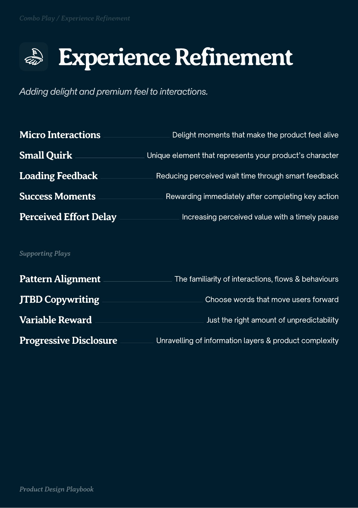

# PDF page 030

Source: `docs/ProductDesignPlaybook_V2.0.pdf`, page 30 of 206.

[Open the full-page screenshot](../../screenshots/page-030.jpg)



## Extracted text

```text
Eperience Refinement

Micro Interactions
Small Quirk

Delight moments that make the product feel alive
Unique element that represents your product’s character

Loading Feedback

Reducing perceived wait time through smart feedback

Success Moments

Rewarding immediately after completing key action

Perceived Effort Delay

Increasing perceived value with a timely pause

Pattern Alignment

The familiarity of interactions, flows & behaviours

JTBD Copywriting

Choose words that move users forward

Variable Reward

Just the right amount of unpredictability

Progressive Disclosure

Unravelling of information layers & product complexity
```
