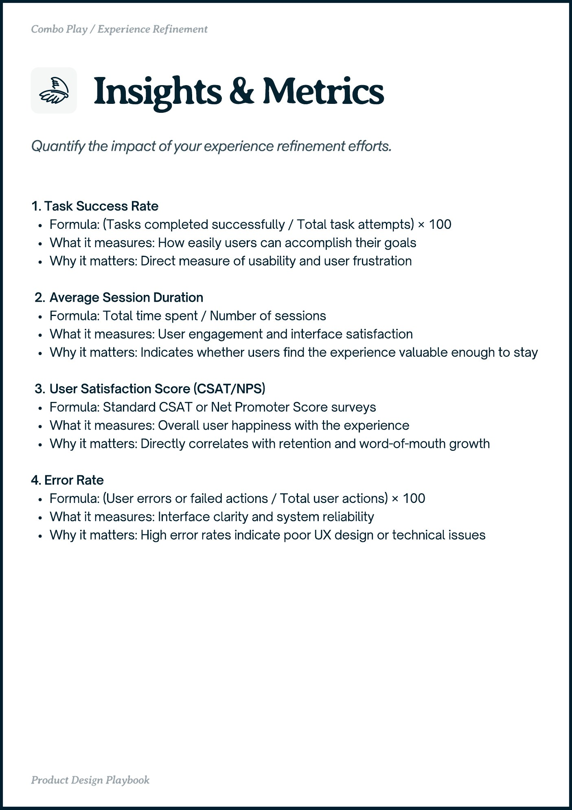

# PDF page 031

Source: `docs/ProductDesignPlaybook_V2.0.pdf`, page 31 of 206.

[Open the full-page screenshot](../../screenshots/page-031.jpg)



## Extracted text

```text
Combo Play / Experience Refinement

1. Task Success Rate

Formula: (Tasks completed successfully / Total task attempts) × 100

What it measures: How easily users can accomplish their goals

Why it matters: Direct measure of usability and user frustration


Average Session Duration

Formula: Total time spent / Number of sessions

What it measures: User engagement and interface satisfaction

Why it matters: Indicates whether users find the experience valuable enough to stay


User Satisfaction Score (CSAT/NPS)

Formula: Standard CSAT or Net Promoter Score surveys

What it measures: Overall user happiness with the experience

Why it matters: Directly correlates with retention and word-of-mouth growth


4. Error Rate

Formula: (User errors or failed actions / Total user actions) × 100

What it measures: Interface clarity and system reliability

Why it matters: High error rates indicate poor UX design or technical issues

Proct ein Playboo
```
