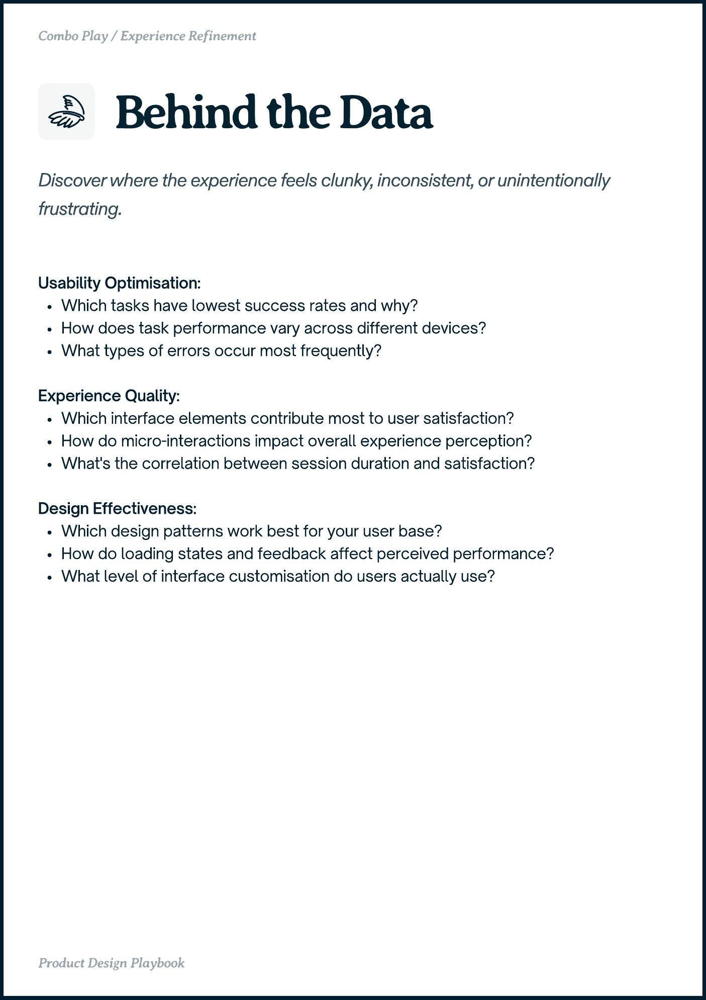

# PDF page 032

Source: `docs/ProductDesignPlaybook_V2.0.pdf`, page 32 of 206.

[Open the full-page screenshot](../../screenshots/page-032.jpg)



## Extracted text

```text
Combo Play / Experience Refinement

Usability Optimisation:

Which tasks have lowest success rates and why?

How does task performance vary across different devices?

What types of errors occur most frequently?


Experience Quality:

Which interface elements contribute most to user satisfaction?

How do micro-interactions impact overall experience perception?

What's the correlation between session duration and satisfaction?


Design Effectiveness:

Which design patterns work best for your user base?

How do loading states and feedback affect perceived performance?

What level of interface customisation do users actually use?

Proct ein Playboo
```
