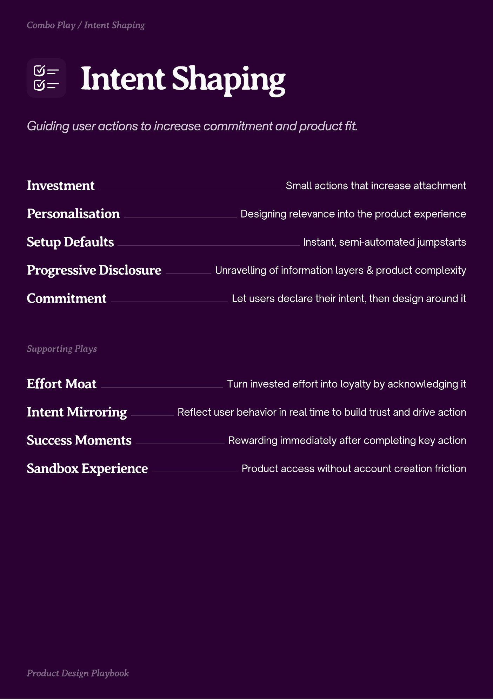

# PDF page 033

Source: `docs/ProductDesignPlaybook_V2.0.pdf`, page 33 of 206.

[Open the full-page screenshot](../../screenshots/page-033.jpg)



## Extracted text

```text
Combo Play / Intent Shaping

Intent Saping
Investment

Small actions that increase attachment

Personalisation

Designing relevance into the product experience

Setup Defaults

Instant, semi-automated jumpstarts

Progressive Disclosure
Commitment

Unravelling of information layers & product complexity
Let users declare their intent, then design around it

Sppting a

Effort Moat

Turn invested effort into loyalty by acknowledging it

Intent Mirroring

Reflect user behavior in real time to build trust and drive action

Success Moments

Rewarding immediately after completing key action

Sandbox Experience

t eign a

Product access without account creation friction
```
