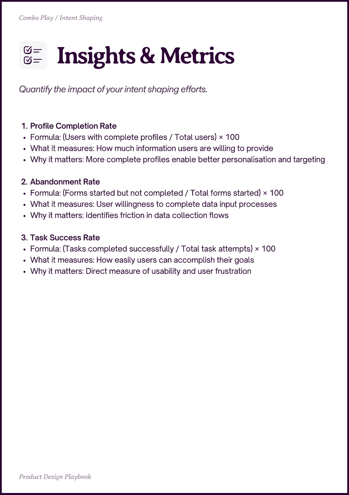

# PDF page 034

Source: `docs/ProductDesignPlaybook_V2.0.pdf`, page 34 of 206.

[Open the full-page screenshot](../../screenshots/page-034.jpg)



## Extracted text

```text
Combo Play / Intent Shaping

Profile Completion Rate

Formula: (Users with complete profiles / Total users) × 100

What it measures: How much information users are willing to provide

Why it matters: More complete profiles enable better personalisation and targeting


Abandonment Rate

Formula: (Forms started but not completed / Total forms started) × 100

What it measures: User willingness to complete data input processes

Why it matters: Identifies friction in data collection flows


Task Success Rate

Formula: (Tasks completed successfully / Total task attempts) × 100

What it measures: How easily users can accomplish their goals

Why it matters: Direct measure of usability and user frustration

Pot eign Playboo
```
