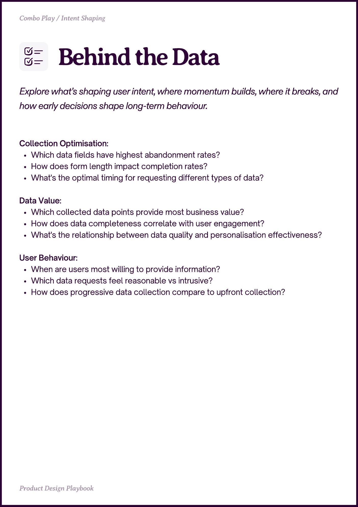

# PDF page 035

Source: `docs/ProductDesignPlaybook_V2.0.pdf`, page 35 of 206.

[Open the full-page screenshot](../../screenshots/page-035.jpg)



## Extracted text

```text
Combo Play / Intent Shaping

Explore what’s shaping user intent, where momentum builds, where it breaks, and
how early decisions shape long-term behaviour.
Collection Optimisation:

Which data fields have highest abandonment rates?

How does form length impact completion rates?

What's the optimal timing for requesting different types of data?


Data Value:

Which collected data points provide most business value?

How does data completeness correlate with user engagement?

What's the relationship between data quality and personalisation effectiveness?


User Behaviour:

When are users most willing to provide information?

Which data requests feel reasonable vs intrusive?

How does progressive data collection compare to upfront collection?

Pot eign Playboo
```
