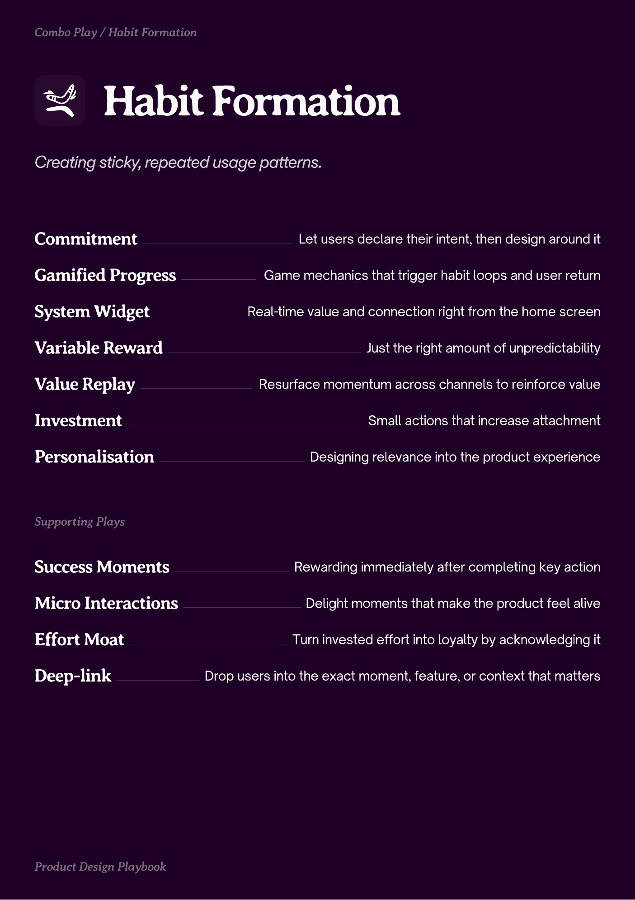

# PDF page 036

Source: `docs/ProductDesignPlaybook_V2.0.pdf`, page 36 of 206.

[Open the full-page screenshot](../../screenshots/page-036.jpg)



## Extracted text

```text
abit ormation

Commitment
Gamified Progress
System Widget
Variable Reward
Value Replay
Investment
Personalisation

Let users declare their intent, then design around it
Game mechanics that trigger habit loops and user return
Real-time value and connection right from the home screen
Just the right amount of unpredictability
Resurface momentum across channels to reinforce value
Small actions that increase attachment
Designing relevance into the product experience

Success Moments

Rewarding immediately after completing key action

Micro Interactions

Delight moments that make the product feel alive

Effort Moat
Deep-link

Turn invested effort into loyalty by acknowledging it
Drop users into the exact moment, feature, or context that matters
```
