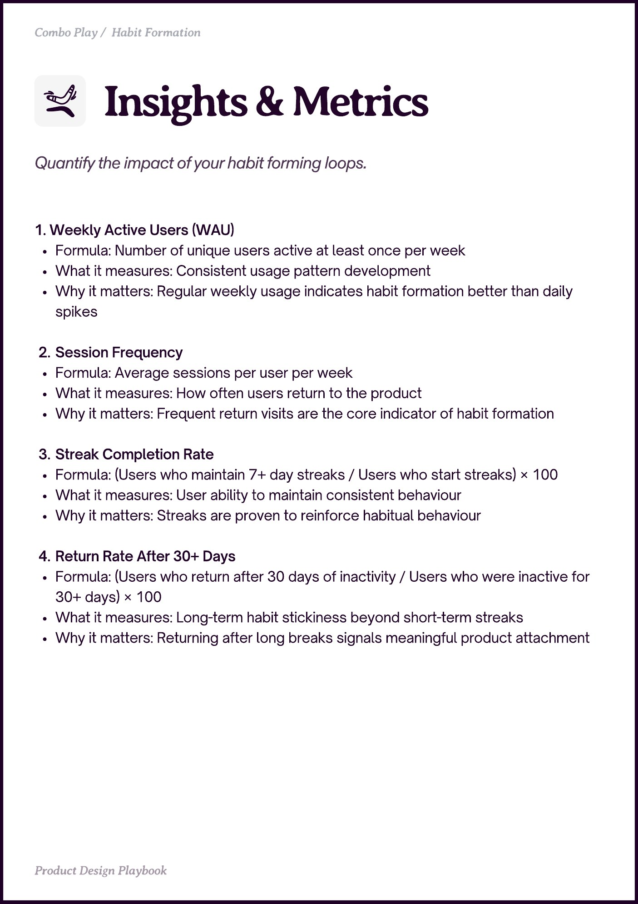

# PDF page 037

Source: `docs/ProductDesignPlaybook_V2.0.pdf`, page 37 of 206.

[Open the full-page screenshot](../../screenshots/page-037.jpg)



## Extracted text

```text
Combo Play / Habit Formation

1. Weekly Active Users (WAU)

Formula: Number of unique users active at least once per week

What it measures: Consistent usage pattern development

Why it matters: Regular weekly usage indicates habit formation better than daily
spikes


Session Frequency

Formula: Average sessions per user per week

What it measures: How often users return to the product

Why it matters: Frequent return visits are the core indicator of habit formation


Streak Completion Rate

Formula: (Users who maintain 7+ day streaks / Users who start streaks) × 100

What it measures: User ability to maintain consistent behaviour

Why it matters: Streaks are proven to reinforce habitual behaviour


Return Rate After 30+ Days

Formula: (Users who return after 30 days of inactivity / Users who were inactive for
30+ days) × 100

What it measures: Long-term habit stickiness beyond short-term streaks

Why it matters: Returning after long breaks signals meaningful product attachment

Prot in Playboo
```
