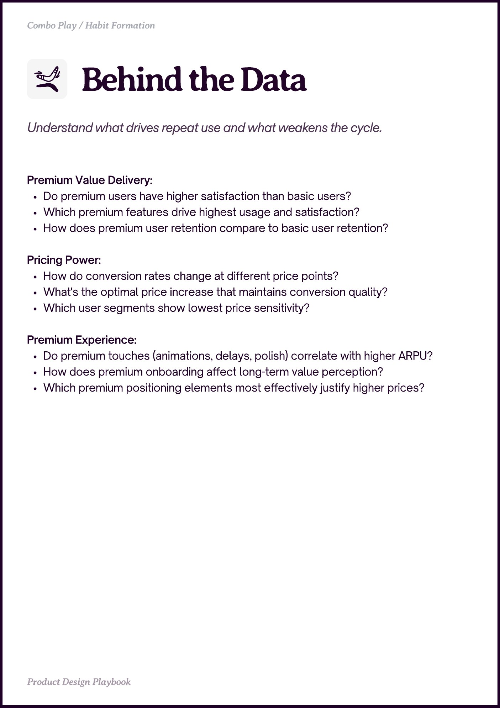

# PDF page 038

Source: `docs/ProductDesignPlaybook_V2.0.pdf`, page 38 of 206.

[Open the full-page screenshot](../../screenshots/page-038.jpg)



## Extracted text

```text
Combo Play / Habit Formation

Premium Value Delivery:

Do premium users have higher satisfaction than basic users?

Which premium features drive highest usage and satisfaction?

How does premium user retention compare to basic user retention?


Pricing Power:

How do conversion rates change at different price points?

What's the optimal price increase that maintains conversion quality?

Which user segments show lowest price sensitivity?


Premium Experience:

Do premium touches (animations, delays, polish) correlate with higher ARPU?

How does premium onboarding affect long-term value perception?

Which premium positioning elements most effectively justify higher prices?

Prot in Playboo
```
