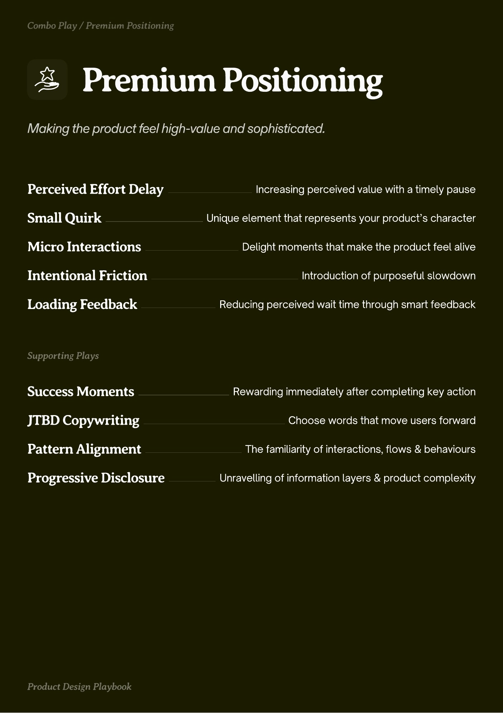

# PDF page 039

Source: `docs/ProductDesignPlaybook_V2.0.pdf`, page 39 of 206.

[Open the full-page screenshot](../../screenshots/page-039.jpg)



## Extracted text

```text
Premium Positioning

Perceived Effort Delay
Small Quirk
Micro Interactions
Intentional Friction

Increasing perceived value with a timely pause

Unique element that represents your product’s character

Delight moments that make the product feel alive

Introduction of purposeful slowdown

Loading Feedback

Reducing perceived wait time through smart feedback

Success Moments

Rewarding immediately after completing key action

JTBD Copywriting

Choose words that move users forward

Pattern Alignment

The familiarity of interactions, flows & behaviours

Progressive Disclosure

Unravelling of information layers & product complexity
```
