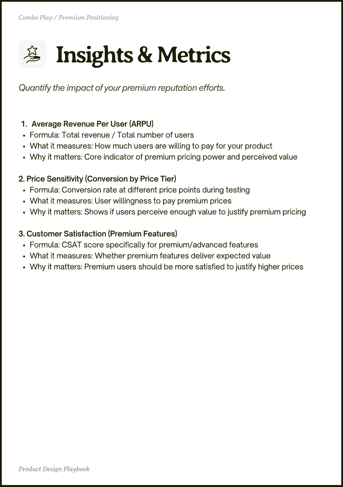

# PDF page 040

Source: `docs/ProductDesignPlaybook_V2.0.pdf`, page 40 of 206.

[Open the full-page screenshot](../../screenshots/page-040.jpg)



## Extracted text

```text
Average Revenue Per User (ARPU)

Formula: Total revenue / Total number of users

What it measures: How much users are willing to pay for your product

Why it matters: Core indicator of premium pricing power and perceived value


2. Price Sensitivity (Conversion by Price Tier)

Formula: Conversion rate at different price points during testing

What it measures: User willingness to pay premium prices

Why it matters: Shows if users perceive enough value to justify premium pricing


3. Customer Satisfaction (Premium Features)

Formula: CSAT score specifically for premium/advanced features

What it measures: Whether premium features deliver expected value

Why it matters: Premium users should be more satisfied to justify higher prices
```
