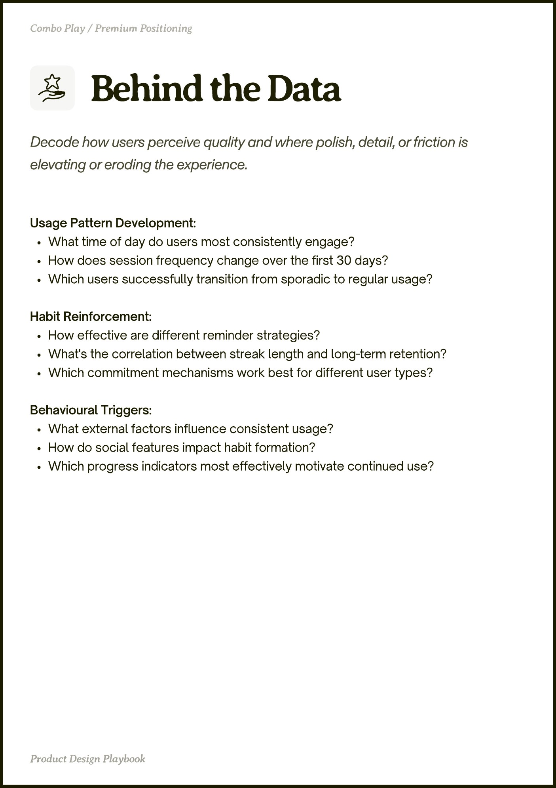

# PDF page 041

Source: `docs/ProductDesignPlaybook_V2.0.pdf`, page 41 of 206.

[Open the full-page screenshot](../../screenshots/page-041.jpg)



## Extracted text

```text
Usage Pattern Development:

What time of day do users most consistently engage?

How does session frequency change over the first 30 days?

Which users successfully transition from sporadic to regular usage?


Habit Reinforcement:

How effective are different reminder strategies?

What's the correlation between streak length and long-term retention?

Which commitment mechanisms work best for different user types?


Behavioural Triggers:

What external factors influence consistent usage?

How do social features impact habit formation?

Which progress indicators most effectively motivate continued use?
```
