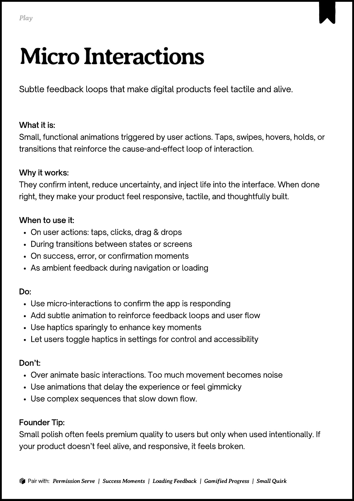

# PDF page 042

Source: `docs/ProductDesignPlaybook_V2.0.pdf`, page 42 of 206.

[Open the full-page screenshot](../../screenshots/page-042.jpg)



## Extracted text

```text
􀉟

Pla

Subtle feedback loops that make digital products feel tactile and alive.

What it is:

Small, functional animations triggered by user actions. Taps, swipes, hovers, holds, or
transitions that reinforce the cause-and-effect loop of interaction.


Why it works:

They confirm intent, reduce uncertainty, and inject life into the interface. When done
right, they make your product feel responsive, tactile, and thoughtfully built.


When to use it:

On user actions: taps, clicks, drag & drops

During transitions between states or screens

On success, error, or confirmation moments

As ambient feedback during navigation or loading


Do:

Use micro-interactions to confirm the app is responding

Add subtle animation to reinforce feedback loops and user flow

Use haptics sparingly to enhance key moments

Let users toggle haptics in settings for control and accessibility


Don’t:

Over animate basic interactions. Too much movement becomes noise

Use animations that delay the experience or feel gimmicky

Use complex sequences that slow down flow.


Founder Tip:

Small polish often feels premium quality to users but only when used intentionally. If
your product doesn’t feel alive, and responsive, it feels broken.

􀰴 Pair with:

Permission Serve

|

Success Moments

|

Loading Feedback

| Gamified Progress

| Small Quirk
```
