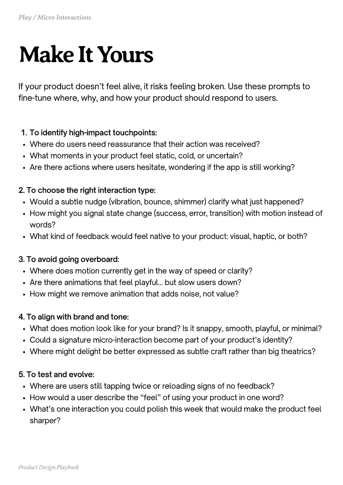

# PDF page 043

Source: `docs/ProductDesignPlaybook_V2.0.pdf`, page 43 of 206.

[Open the full-page screenshot](../../screenshots/page-043.jpg)



## Extracted text

```text
If your product doesn’t feel alive, it risks feeling broken. Use these prompts to
fine-tune where, why, and how your product should respond to users.
To identify high-impact touchpoints:

Where do users need reassurance that their action was received?

What moments in your product feel static, cold, or uncertain?

Are there actions where users hesitate, wondering if the app is still working?


2. To choose the right interaction type:

Would a subtle nudge (vibration, bounce, shimmer) clarify what just happened?

How might you signal state change (success, error, transition) with motion instead of
words?

What kind of feedback would feel native to your product: visual, haptic, or both?


3. To avoid going overboard:

Where does motion currently get in the way of speed or clarity?

Are there animations that feel playful… but slow users down?

How might we remove animation that adds noise, not value?


4. To align with brand and tone:

What does motion look like for your brand? Is it snappy, smooth, playful, or minimal?

Could a signature micro-interaction become part of your product’s identity?

Where might delight be better expressed as subtle craft rather than big theatrics?


5. To test and evolve:

Where are users still tapping twice or reloading signs of no feedback?

How would a user describe the “feel” of using your product in one word?

What’s one interaction you could polish this week that would make the product feel
sharper?

Product Design Playbook
```
