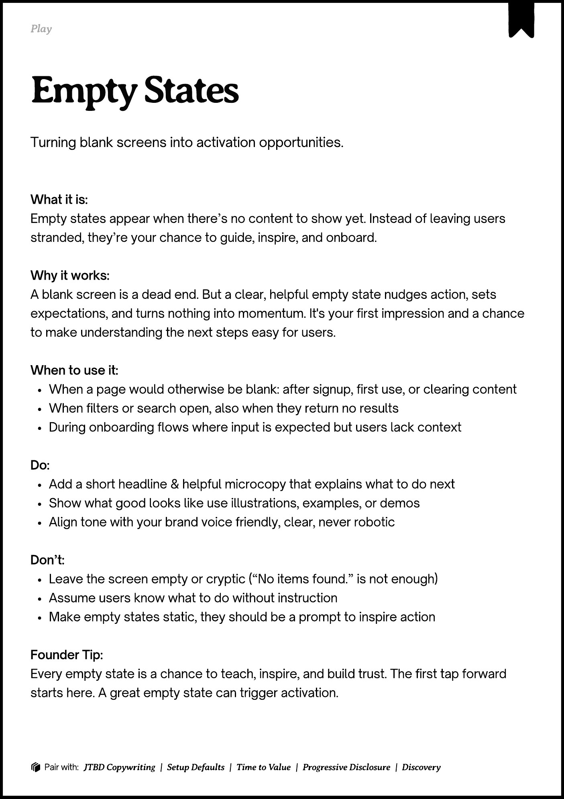

# PDF page 047

Source: `docs/ProductDesignPlaybook_V2.0.pdf`, page 47 of 206.

[Open the full-page screenshot](../../screenshots/page-047.jpg)



## Extracted text

```text
􀉟

Play

Turning blank screens into activation opportunities.

What it is:

Empty states appear when there’s no content to show yet. Instead of leaving users
stranded, they’re your chance to guide, inspire, and onboard.


Why it works:

A blank screen is a dead end. But a clear, helpful empty state nudges action, sets
expectations, and turns nothing into momentum. It's your first impression and a chance
to make understanding the next steps easy for users.


When to use it:

When a page would otherwise be blank: after signup, first use, or clearing content

When filters or search open, also when they return no results

During onboarding flows where input is expected but users lack context


Do:

Add a short headline & helpful microcopy that explains what to do next

Show what good looks like use illustrations, examples, or demos

Align tone with your brand voice friendly, clear, never robotic


Don’t:

Leave the screen empty or cryptic (“No items found.” is not enough)

Assume users know what to do without instruction

Make empty states static, they should be a prompt to inspire action


Founder Tip:

Every empty state is a chance to teach, inspire, and build trust. The first tap forward
starts here. A great empty state can trigger activation.

􀰴 Pair with:

JTBD Copywriting

| Setup Defaults |

Time to Value

|

Progressive Disclosure

| Discovery
```
