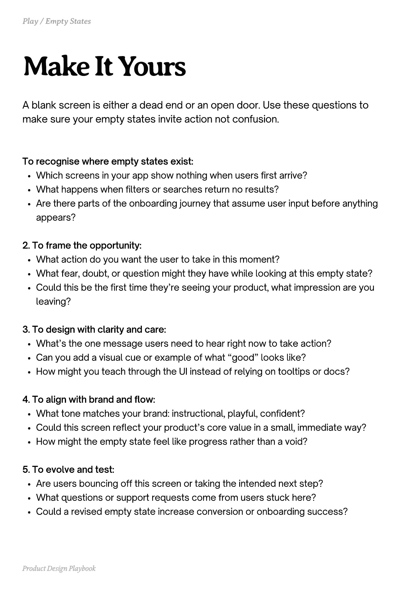

# PDF page 048

Source: `docs/ProductDesignPlaybook_V2.0.pdf`, page 48 of 206.

[Open the full-page screenshot](../../screenshots/page-048.jpg)



## Extracted text

```text
A blank screen is either a dead end or an open door. Use these questions to
make sure your empty states invite action not confusion.

To recognise where empty states exist:

Which screens in your app show nothing when users first arrive?

What happens when filters or searches return no results?

Are there parts of the onboarding journey that assume user input before anything
appears?



2. To frame the opportunity:

What action do you want the user to take in this moment?

What fear, doubt, or question might they have while looking at this empty state?

Could this be the first time they’re seeing your product, what impression are you
leaving?



3. To design with clarity and care:

What’s the one message users need to hear right now to take action?

Can you add a visual cue or example of what “good” looks like?

How might you teach through the UI instead of relying on tooltips or docs?



4. To align with brand and flow:

What tone matches your brand: instructional, playful, confident?

Could this screen reflect your product’s core value in a small, immediate way?

How might the empty state feel like progress rather than a void?



5. To evolve and test:

Are users bouncing off this screen or taking the intended next step?

What questions or support requests come from users stuck here?

Could a revised empty state increase conversion or onboarding success?

Product Design Playbook
```
