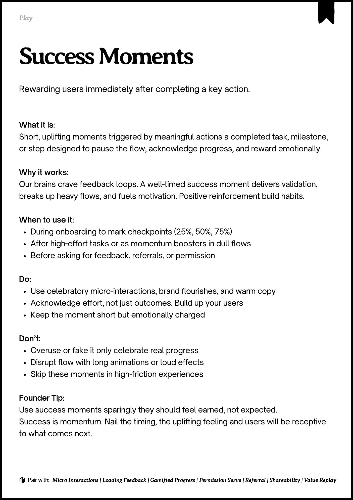

# PDF page 052

Source: `docs/ProductDesignPlaybook_V2.0.pdf`, page 52 of 206.

[Open the full-page screenshot](../../screenshots/page-052.jpg)



## Extracted text

```text
􀉟

Play

Rewarding users immediately after completing a key action.

What it is:

Short, uplifting moments triggered by meaningful actions a completed task, milestone,
or step designed to pause the flow, acknowledge progress, and reward emotionally.



Why it works:

Our brains crave feedback loops. A well-timed success moment delivers validation,
breaks up heavy flows, and fuels motivation. Positive reinforcement build habits.


When to use it:

During onboarding to mark checkpoints (25%, 50%, 75%)

After high-effort tasks or as momentum boosters in dull flows

Before asking for feedback, referrals, or permission


Do:

Use celebratory micro-interactions, brand flourishes, and warm copy

Acknowledge effort, not just outcomes. Build up your users 

Keep the moment short but emotionally charged


Don’t:

Overuse or fake it only celebrate real progress

Disrupt flow with long animations or loud effects

Skip these moments in high-friction experiences


Founder Tip:

Use success moments sparingly they should feel earned, not expected.

Success is momentum. Nail the timing, the uplifting feeling and users will be receptive
to what comes next.

􀰴 Pair with:

Micro Interactions | Loading Feedback | Gamified Progress | Permission Serve | Referral | Shareability | Value Replay
```
