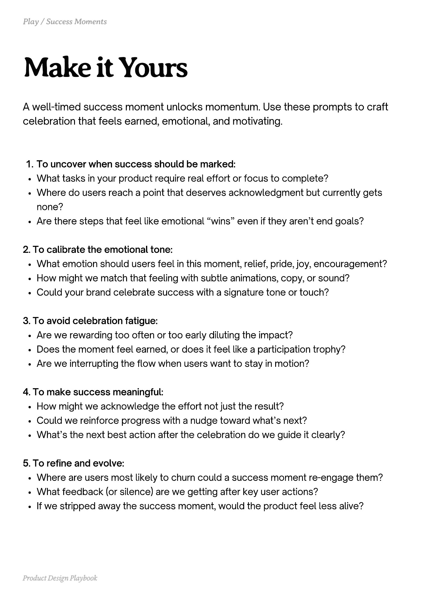

# PDF page 053

Source: `docs/ProductDesignPlaybook_V2.0.pdf`, page 53 of 206.

[Open the full-page screenshot](../../screenshots/page-053.jpg)



## Extracted text

```text
A well-timed success moment unlocks momentum. Use these prompts to craft
celebration that feels earned, emotional, and motivating.
To uncover when success should be marked:

What tasks in your product require real effort or focus to complete?

Where do users reach a point that deserves acknowledgment but currently gets
none?

Are there steps that feel like emotional “wins” even if they aren’t end goals?


2. To calibrate the emotional tone:

What emotion should users feel in this moment, relief, pride, joy, encouragement?

How might we match that feeling with subtle animations, copy, or sound?

Could your brand celebrate success with a signature tone or touch?


3. To avoid celebration fatigue:

Are we rewarding too often or too early diluting the impact?

Does the moment feel earned, or does it feel like a participation trophy?

Are we interrupting the flow when users want to stay in motion?


4. To make success meaningful:

How might we acknowledge the effort not just the result?

Could we reinforce progress with a nudge toward what’s next?

What’s the next best action after the celebration do we guide it clearly?


5. To refine and evolve:

Where are users most likely to churn could a success moment re-engage them?

What feedback (or silence) are we getting after key user actions?

If we stripped away the success moment, would the product feel less alive?

Product Design Playbook
```
