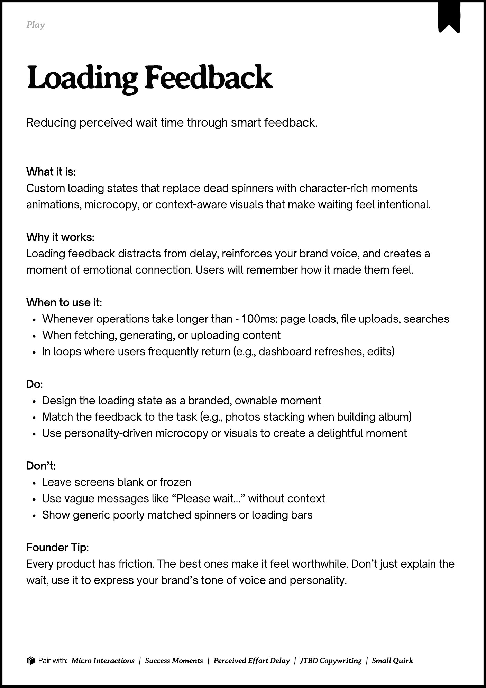

# PDF page 057

Source: `docs/ProductDesignPlaybook_V2.0.pdf`, page 57 of 206.

[Open the full-page screenshot](../../screenshots/page-057.jpg)



## Extracted text

```text
􀉟

Play

Reducing perceived wait time through smart feedback.

What it is:

Custom loading states that replace dead spinners with character-rich moments
animations, microcopy, or context-aware visuals that make waiting feel intentional.



Why it works:

Loading feedback distracts from delay, reinforces your brand voice, and creates a
moment of emotional connection. Users will remember how it made them feel.


When to use it:

Whenever operations take longer than ~100ms: page loads, file uploads, searches

When fetching, generating, or uploading content

In loops where users frequently return (e.g., dashboard refreshes, edits)


Do:

Design the loading state as a branded, ownable moment

Match the feedback to the task (e.g., photos stacking when building album)

Use personality-driven microcopy or visuals to create a delightful moment


Don’t:

Leave screens blank or frozen

Use vague messages like “Please wait…” without context

Show generic poorly matched spinners or loading bars


Founder Tip:

Every product has friction. The best ones make it feel worthwhile. Don’t just explain the
wait, use it to express your brand’s tone of voice and personality.

􀰴 Pair with: Micro Interactions

|

Success Moments

|

Perceived Effort Delay

|

JTBD Copywriting

| Small Quirk
```
