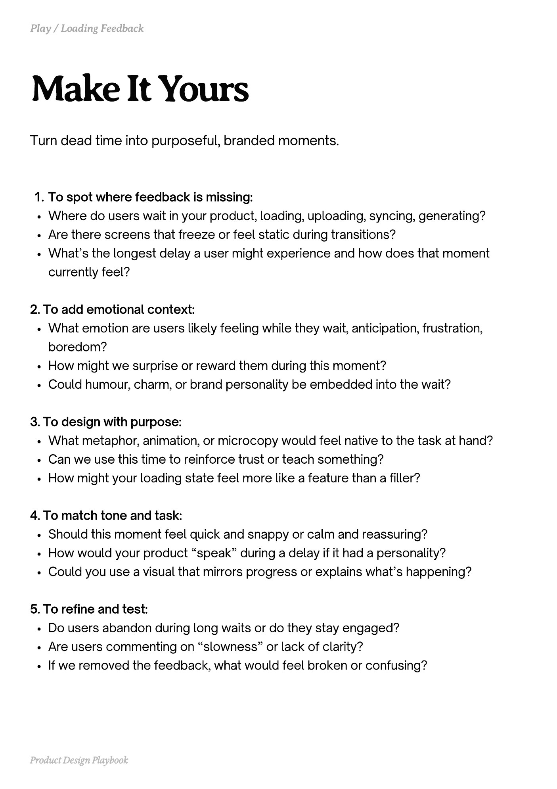

# PDF page 058

Source: `docs/ProductDesignPlaybook_V2.0.pdf`, page 58 of 206.

[Open the full-page screenshot](../../screenshots/page-058.jpg)



## Extracted text

```text
Turn dead time into purposeful, branded moments.

To spot where feedback is missing:

Where do users wait in your product, loading, uploading, syncing, generating?

Are there screens that freeze or feel static during transitions?

What’s the longest delay a user might experience and how does that moment
currently feel?



2. To add emotional context:

What emotion are users likely feeling while they wait, anticipation, frustration,
boredom?

How might we surprise or reward them during this moment?

Could humour, charm, or brand personality be embedded into the wait?



3. To design with purpose:

What metaphor, animation, or microcopy would feel native to the task at hand?

Can we use this time to reinforce trust or teach something?

How might your loading state feel more like a feature than a filler?



4. To match tone and task:

Should this moment feel quick and snappy or calm and reassuring?

How would your product “speak” during a delay if it had a personality?

Could you use a visual that mirrors progress or explains what’s happening?



5. To refine and test:

Do users abandon during long waits or do they stay engaged?

Are users commenting on “slowness” or lack of clarity?

If we removed the feedback, what would feel broken or confusing?

Product Design Playbook
```
