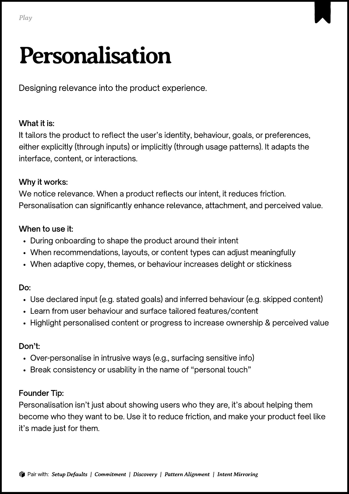

# PDF page 062

Source: `docs/ProductDesignPlaybook_V2.0.pdf`, page 62 of 206.

[Open the full-page screenshot](../../screenshots/page-062.jpg)



## Extracted text

```text
􀉟

Play

Designing relevance into the product experience.

What it is:

It tailors the product to reflect the user’s identity, behaviour, goals, or preferences,
either explicitly (through inputs) or implicitly (through usage patterns). It adapts the
interface, content, or interactions.


Why it works:

We notice relevance. When a product reflects our intent, it reduces friction.
Personalisation can significantly enhance relevance, attachment, and perceived value.



When to use it:

During onboarding to shape the product around their intent

When recommendations, layouts, or content types can adjust meaningfully

When adaptive copy, themes, or behaviour increases delight or stickiness


Do:

Use declared input (e.g. stated goals) and inferred behaviour (e.g. skipped content)

Learn from user behaviour and surface tailored features/content

Highlight personalised content or progress to increase ownership & perceived value


Don’t:

Over-personalise in intrusive ways (e.g., surfacing sensitive info)

Break consistency or usability in the name of “personal touch”


Founder Tip:

Personalisation isn’t just about showing users who they are, it’s about helping them
become who they want to be. Use it to reduce friction, and make your product feel like
it’s made just for them.

􀰴 Pair with:

Setup Defaults | Commitment | Discovery |

Pattern Alignment

|

Intent Mirroring
```
