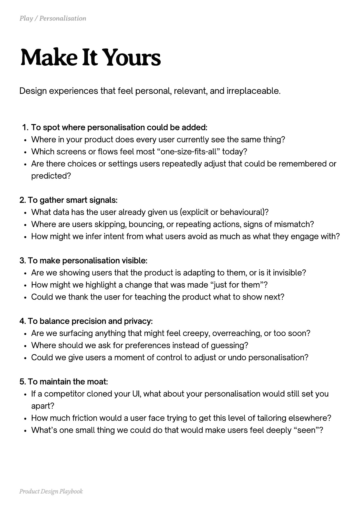

# PDF page 063

Source: `docs/ProductDesignPlaybook_V2.0.pdf`, page 63 of 206.

[Open the full-page screenshot](../../screenshots/page-063.jpg)



## Extracted text

```text
Design experiences that feel personal, relevant, and irreplaceable.

To spot where personalisation could be added:

Where in your product does every user currently see the same thing?

Which screens or flows feel most “one-size-fits-all” today?

Are there choices or settings users repeatedly adjust that could be remembered or
predicted?



2. To gather smart signals:

What data has the user already given us (explicit or behavioural)?

Where are users skipping, bouncing, or repeating actions, signs of mismatch?

How might we infer intent from what users avoid as much as what they engage with?



3. To make personalisation visible:

Are we showing users that the product is adapting to them, or is it invisible?

How might we highlight a change that was made “just for them”?

Could we thank the user for teaching the product what to show next?



4. To balance precision and privacy:

Are we surfacing anything that might feel creepy, overreaching, or too soon?

Where should we ask for preferences instead of guessing?

Could we give users a moment of control to adjust or undo personalisation?



5. To maintain the moat:

If a competitor cloned your UI, what about your personalisation would still set you
apart?

How much friction would a user face trying to get this level of tailoring elsewhere?

What’s one small thing we could do that would make users feel deeply “seen”?

Product Design Playbook
```
