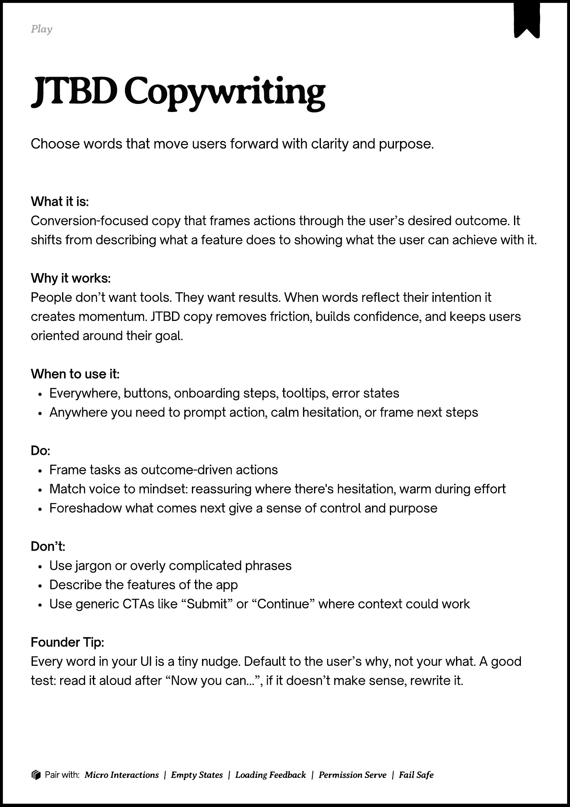

# PDF page 067

Source: `docs/ProductDesignPlaybook_V2.0.pdf`, page 67 of 206.

[Open the full-page screenshot](../../screenshots/page-067.jpg)



## Extracted text

```text
􀉟

Play

Choose words that move users forward with clarity and purpose.

What it is:

Conversion-focused copy that frames actions through the user’s desired outcome. It
shifts from describing what a feature does to showing what the user can achieve with it.


Why it works:

People don’t want tools. They want results. When words reflect their intention it
creates momentum. JTBD copy removes friction, builds confidence, and keeps users
oriented around their goal.


When to use it:

Everywhere, buttons, onboarding steps, tooltips, error states

Anywhere you need to prompt action, calm hesitation, or frame next steps


Do:

Frame tasks as outcome-driven actions

Match voice to mindset: reassuring where there's hesitation, warm during effort

Foreshadow what comes next give a sense of control and purpose


Don’t:

Use jargon or overly complicated phrases

Describe the features of the app

Use generic CTAs like “Submit” or “Continue” where context could work


Founder Tip:

Every word in your UI is a tiny nudge. Default to the user’s why, not your what. A good
test: read it aloud after “Now you can…”, if it doesn’t make sense, rewrite it.

􀰴 Pair with:

Micro Interactions

|

Empty States

|

Loading Feedback

|

Permission Serve

|

Fail Safe
```
