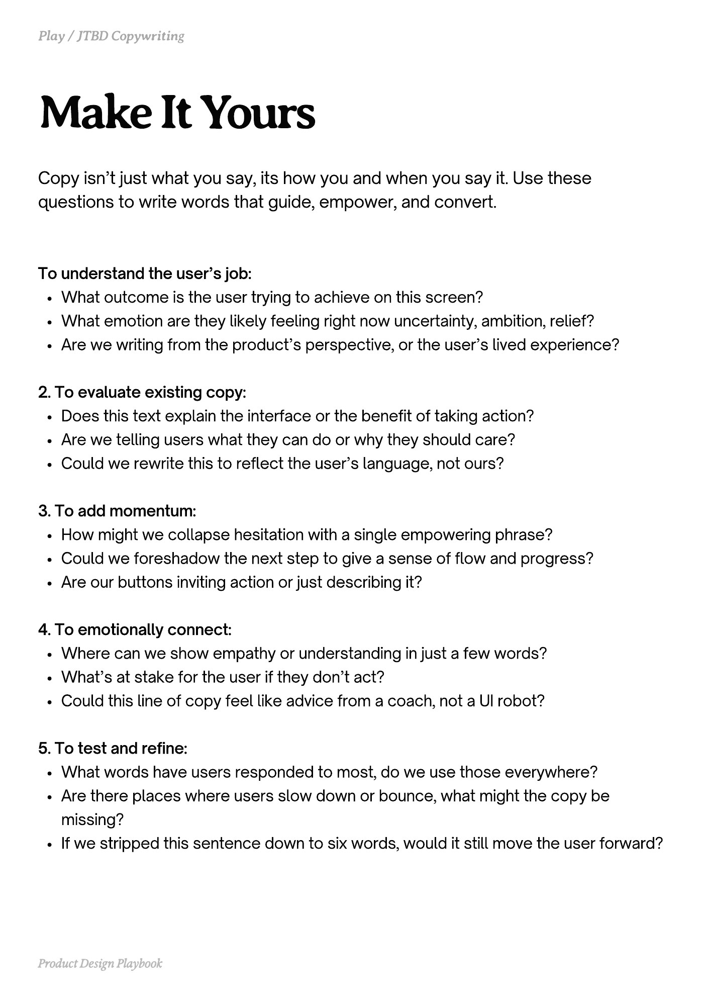

# PDF page 068

Source: `docs/ProductDesignPlaybook_V2.0.pdf`, page 68 of 206.

[Open the full-page screenshot](../../screenshots/page-068.jpg)



## Extracted text

```text
Copy isn’t just what you say, its how you and when you say it. Use these
questions to write words that guide, empower, and convert.

To understand the user’s job:

What outcome is the user trying to achieve on this screen?

What emotion are they likely feeling right now uncertainty, ambition, relief?

Are we writing from the product’s perspective, or the user’s lived experience?


2. To evaluate existing copy:

Does this text explain the interface or the benefit of taking action?

Are we telling users what they can do or why they should care?

Could we rewrite this to reflect the user’s language, not ours?


3. To add momentum:

How might we collapse hesitation with a single empowering phrase?

Could we foreshadow the next step to give a sense of flow and progress?

Are our buttons inviting action or just describing it?


4. To emotionally connect:

Where can we show empathy or understanding in just a few words?

What’s at stake for the user if they don’t act?

Could this line of copy feel like advice from a coach, not a UI robot?


5. To test and refine:

What words have users responded to most, do we use those everywhere?

Are there places where users slow down or bounce, what might the copy be
missing?

If we stripped this sentence down to six words, would it still move the user forward?

Product Design Playbook
```
