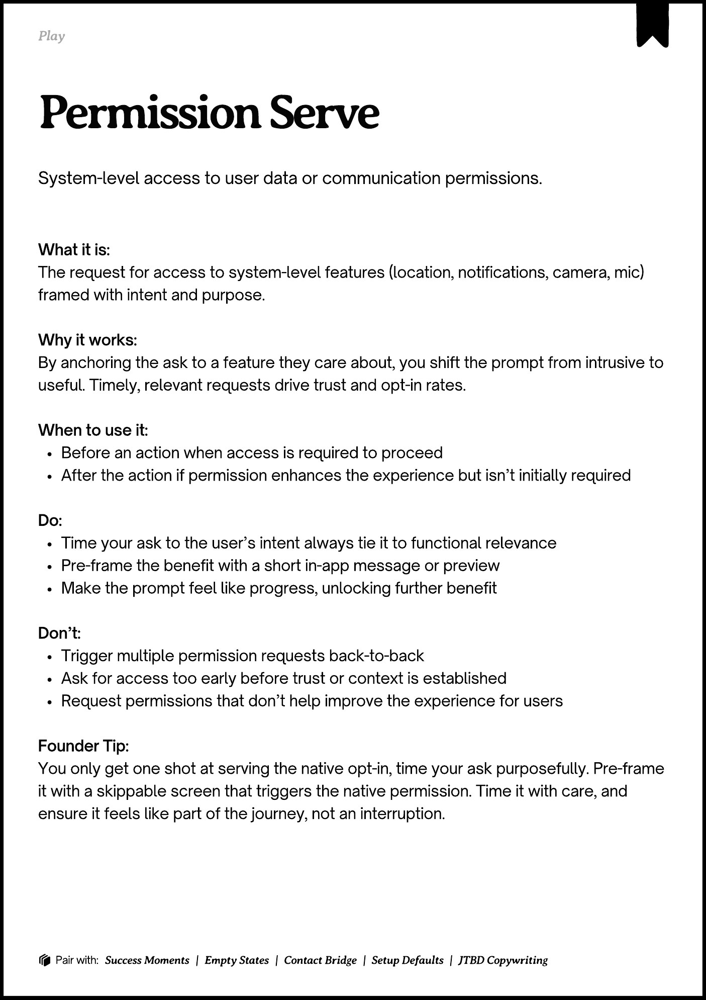

# PDF page 072

Source: `docs/ProductDesignPlaybook_V2.0.pdf`, page 72 of 206.

[Open the full-page screenshot](../../screenshots/page-072.jpg)



## Extracted text

```text
􀉟

lay

System-level access to user data or communication permissions.

What it is:

The request for access to system-level features (location, notifications, camera, mic)
framed with intent and purpose.


Why it works:

By anchoring the ask to a feature they care about, you shift the prompt from intrusive to
useful. Timely, relevant requests drive trust and opt-in rates.


When to use it:

Before an action when access is required to proceed

After the action if permission enhances the experience but isn’t initially required


Do:

Time your ask to the user’s intent always tie it to functional relevance

Pre-frame the benefit with a short in-app message or preview

Make the prompt feel like progress, unlocking further benefit


Don’t:

Trigger multiple permission requests back-to-back

Ask for access too early before trust or context is established

Request permissions that don’t help improve the experience for users 


Founder Tip:

You only get one shot at serving the native opt-in, time your ask purposefully. Pre-frame
it with a skippable screen that triggers the native permission. Time it with care, and
ensure it feels like part of the journey, not an interruption.

􀰴 Pair with: Success Moments | Empty States | Contact Bridge | Setup Defaults | JTBD Copywriting
```
